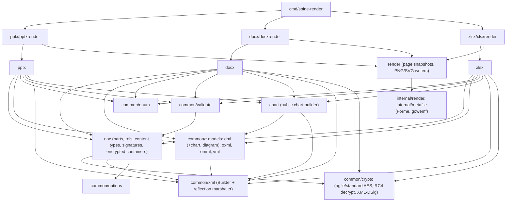
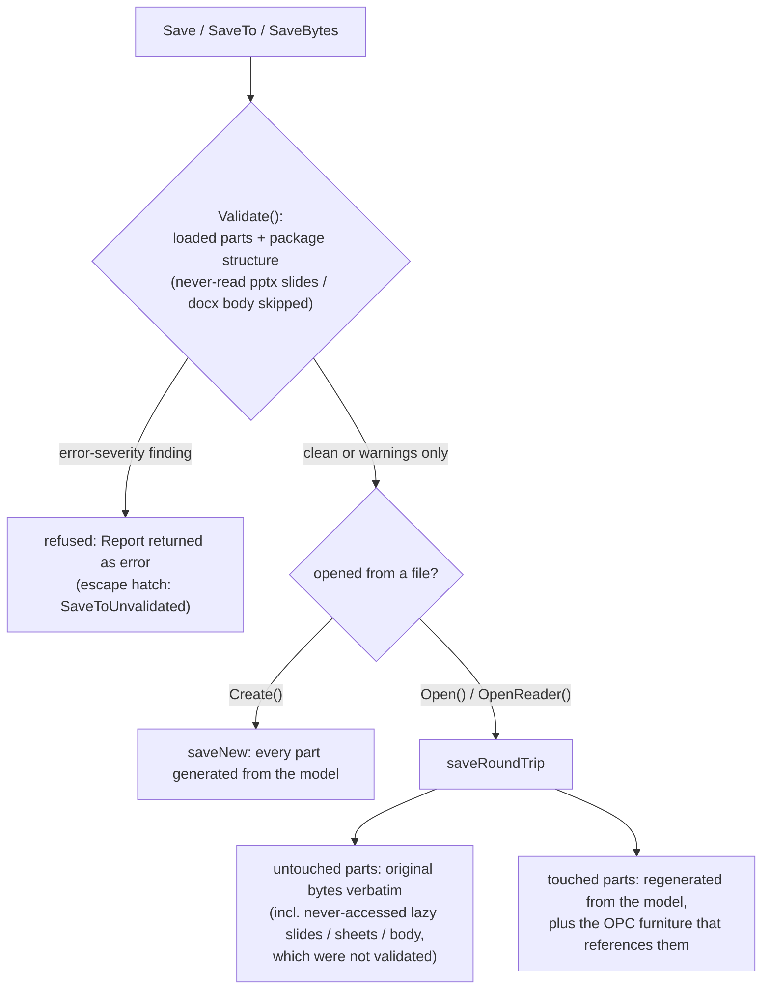

# Architecture

How spine is put together, drawn rather than narrated. For the round-trip
contract that underlies all of it, see
[CONTRIBUTING § Round-trip philosophy](../CONTRIBUTING.md#round-trip-philosophy).

## Package layering

- **opc** is the OPC container: parts, relationships, `[Content_Types].xml`,
  package signatures, and the CFB-wrapped encrypted containers. It depends only
  on `common/crypto`, `common/xml`, and `common/options` (the shared functional
  options type behind `opc.WithPassword` and the `WithMax*` limits).
- **common/xml** is the write substrate — the `Builder` and the reflection
  marshaler that every XML part is serialized through. It has no spine
  dependencies (Go stdlib only), which is why it sits at the bottom.
- **The shared models** (`common/dml` and its `chart`/`diagram` children,
  `oxml`, `omml`, `vml`) are the typed OOXML structs, and all of them marshal
  through `common/xml`. `common/enum` is the one pure leaf.
- **common/validate** is the pre-save checker. It depends on `opc` (it inspects
  the assembled package), so it is not a bottom-level leaf.
- **chart** is the public chart builder; it composes `common/dml`(/chart) values
  and writes them through `common/xml`.
- **pptx / docx / xlsx** are the format packages. Each imports `opc`, the
  models, `validate`, and `chart`, and each reaches password encryption through
  `opc`'s CFB bridge — reading via `opc.WithPassword` on its ordinary open,
  writing through its own `SaveEncrypted` pair. Each also has an `internal/oxml`
  package for its format-specific structs.
- **The render tier** sits on top and points one way. `pptxrender`,
  `docxrender` and `xlsxrender` turn an opened document into `render.Page`
  snapshots, drawn by `internal/render` with [Forme](https://github.com/mgilbir/forme),
  and with [gowemf](https://github.com/mgilbir/gowemf) for EMF/WMF pictures.
  No format package imports them, so a program that imports only `pptx`,
  `docx` or `xlsx` links neither the renderer nor its dependencies.
  `cmd/spine-render` wraps all three, adding aster to draw charts. See the
  [rendering guide](rendering.md).

## Save pipeline

`SaveTo` runs `Validate()` first and returns the `Report` as an error on any
error-severity finding, so an edit cannot introduce a structural error;
`SaveToUnvalidated` is the escape hatch. The check covers what is loaded plus
the package structure. A pptx slide or the docx body that was never read is not
parsed to be checked; it passes through verbatim, defects included, and is
checked from the moment something reads it. xlsx's `Validate()` loads every
sheet, so it has no such gap. (`xlsx` also refuses an empty workbook
with `ErrNoSheets` ahead of the gate.) The origin decides the rest: a document
built with `Create` regenerates every part (`saveNew`), while one opened from a
file takes `saveRoundTrip`, writing untouched parts verbatim and regenerating
only the ones the session touched.

## Lazy-parse part lifecycle

```mermaid
stateDiagram-v2
    [*] --> Raw: Open() parse-checks the part, then discards the model
    Raw --> Parsed: first read (Slide shapes / Sheet cells / Document body)
    Parsed --> Dirty: any mutation
    Raw --> [*]: Save writes original bytes verbatim
    Parsed --> [*]: Save re-emits the part (xlsx: original bytes; pptx/docx: re-marshal, near-always byte-identical)
    Dirty --> [*]: Save regenerates the part from the model
```

Slides (`pptx`), sheets (`xlsx`), and the document body (`docx`) are parsed
once at `Open`, to reject malformed XML, and then discarded; the model is
re-parsed only on first access. The parse at `Open` is not `Validate()`: a
well-formed part with a structural error, such as a duplicate shape id, passes
it.
Reading never marks a part dirty, but what "unedited" buys you differs by format,
in three tiers:

1. A part **never accessed at all** keeps its model nil and passes through
   verbatim — guaranteed byte-identical.
2. `xlsx` re-emits a clean parsed sheet's **original bytes** (it regenerates only
   when the sheet is `dirty`), so an accessed-but-unedited sheet is byte-identical
   too.
3. `pptx` and `docx` **re-marshal** an accessed slide/body from its model rather
   than replaying its bytes. This reproduces the original for the overwhelming
   majority of files, but it can drift from a whitespace-preserving producer's
   exact bytes — so merely *reading* a slide or the body can cost byte-identity on
   a small fraction (~1%) of wild files. That is why `pptx` keeps a
   never-materialized slide on the verbatim path instead (corpus: all 1200 decks
   round-trip byte-identical via pass-through, versus 1189 when every slide is
   regenerated; docx 1196 versus 1194).

One nuance: `ReplaceText` reads what it scans. In `pptx` every slide, and in
`docx` the body, moves to *Parsed* even where no key matched. On save they are
re-marshaled, so tier 3 applies: usually byte-identical, but no longer on the
never-accessed verbatim path. `xlsx` scans sheets without leaving a part dirty
when nothing matched, so tier 2 keeps them byte-identical.

## Round-trip fidelity model

The invariant behind every diagram above is **byte-identity for unmodified
content**: opening and saving reproduces every part byte-for-byte — verbatim for
a part the session never materializes, and subject to the tier-3 re-marshal
caveat above for an accessed-but-unedited `pptx`/`docx` part — and mutating one
part never disturbs another's bytes. A second invariant follows —
**childOrder**: parsed parts record the order of their children (including
unknown, raw-captured elements) so they re-serialize in the original sequence,
and every mutator that appends to a typed slice must maintain that bookkeeping.
Markup the typed model does not represent is captured verbatim and replayed on
save, so unknown content survives a round trip untouched. Both invariants and
the tests that enforce them are described in
[CONTRIBUTING § Round-trip philosophy](../CONTRIBUTING.md#round-trip-philosophy).

## Why it is built this way

**Lazy parsing.** Opening a document used to build a model of every slide,
sheet and document body and hold it for the document's lifetime, even when
the caller only read a little or saved it unchanged. Parsing on first access
cut the heap retained after open from ~506 MB to ~1 MB on a 51 MB Word body,
by ~75% on a 21 MB worksheet, and by ~28% on a 39-slide deck. It also improved
fidelity: a part passed through is always byte-identical, where a regenerated
one occasionally drifted. The figures are in the [0.1.0 changelog](../CHANGELOG.md#010---2026-07-22).

**Why the save check skips parts nothing has read.** Checking a slide or a
body means parsing it, which is the cost lazy parsing exists to avoid, and a
part nobody has touched is written back byte-for-byte, so spine cannot have
introduced a defect into it. The price is that a defect the input already
had passes through unreported until something reads that part
([Save refused after only reading a file](troubleshooting.md#save-refused-after-only-reading-a-file)).

**Why xlsx keeps an accessed sheet's bytes and pptx/docx do not.** xlsx wrote
unmodified sheets from their preserved bytes, with an explicit dirty flag,
before parsing became lazy; reading a sheet never set the flag. pptx and docx
regenerated every slide and body from its model, and lazy parsing gave them a
verbatim path only for a part that is never parsed. Whether pptx and docx
should gain the same dirty tracking is not recorded as a decision.

**Dependencies.** The format packages link no third-party code. Rendering adds
Forme and gowemf, and the command-line renderer adds aster for charts; the
rendering plan's "Forme only" rule predates those. Which module is there for
what, and who imports it: [CONTRIBUTING § Dependencies](../CONTRIBUTING.md#dependencies).

