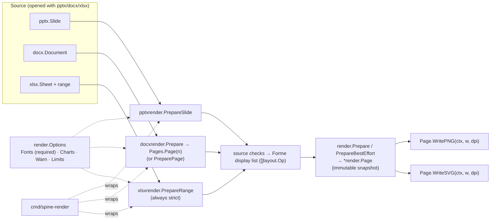
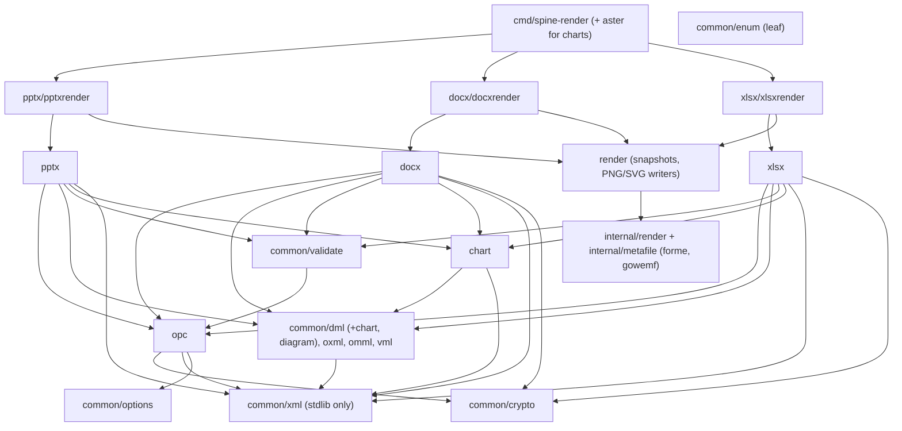
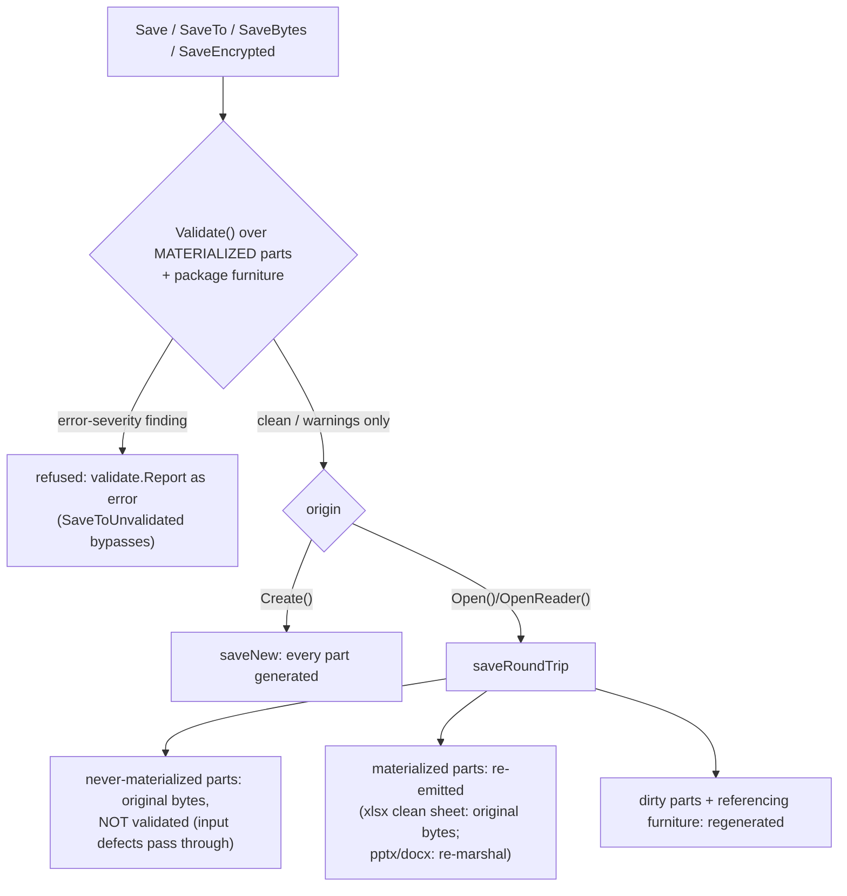
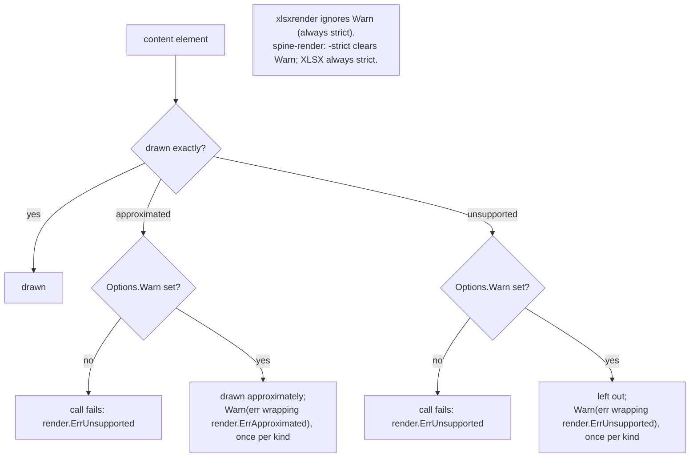
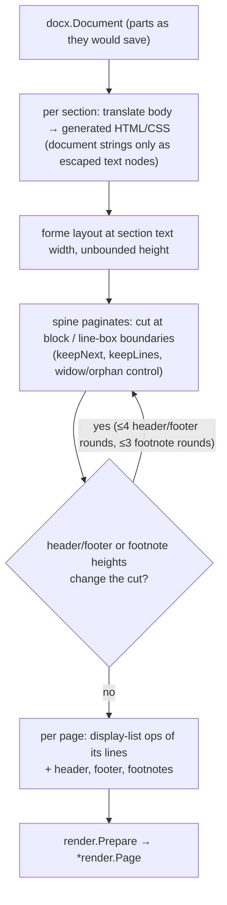

# Spine Documentation Audit — 2026-10-11

This audits every reader-facing surface at HEAD `2cb7c42` (v0.4.0, released the previous day). It is the third docs audit. The 2026-07-07 audit used D1–D30 and the 2026-07-26 audit used D31–D49, so **IDs here continue the series at D50**. A fixing agent can cite any D-number without ambiguity.

**Scope.** The audit read these surfaces in full:
- README.md (375 lines)
- docs/README.md
- docs/architecture.md
- docs/troubleshooting.md
- docs/pptx.md, docs/docx.md, docs/xlsx.md
- docs/charts.md
- docs/encryption-and-signing.md
- docs/rendering.md (1343 lines)
- docs/png-rendering-plan.md
- CONTRIBUTING.md
- CHANGELOG.md (0.3.0–0.4.0 in full, earlier releases skimmed)
- spec/README.md
- testdata/README.md, testdata/cc/README.md, testdata/cc/HARVEST.md
- docs/audits/README.md
- internal/render/README.md
- the Makefile comments
- the `spine-render` and `tools/fidelity` `-help` output and flag definitions
- `tools/ccfetch` and `tools/ccrun` headers
- the package docs of all 22 public packages, plus lifecycle godoc
- all 11 `examples/` programs
- the godoc `Example` functions

**Method.** Every claim was checked against the code as follows:
- **Snippets.** All 9 entry-doc snippets and all 16 guide snippets were compiled. They were run in scratch modules under `/tmp/docsaudit-*`, each with a `replace` pointing at the repo.
- **Snippet outcomes.** Behavior was asserted after a save and reopen, never on the in-memory handle.
- **Examples.** All 11 examples were built and run outside the tree.
- **Symbols.** About 430 backticked guide symbols and about 62 package-doc identifiers were resolved with `go doc`.
- **CLI.** The CLI was built and every flag was diffed against its source.
- **Links.** All relative links and anchors were checked against GitHub slug rules: 79 in the entry docs, 10 in the guides and 6 in the contributor docs.
- **Disproof.** Each finding was tested with an attempt to disprove it first. Every high finding, and the medium findings marked CONFIRMED, was reproduced independently by the report author as well as by the slice agent.

**Headline.** The docs are accurate where they are old and inaccurate where they are new.
- The README, the validation catalog, the resource limits, units, flavors, the encryption how-to and the HARVEST tables all check out to the number:
  - 28 of 28 validation codes and severities match.
  - 5 of 5 limits and defaults match.
  - 429 of 431 guide symbols resolve.
  - 17 of 17 render limit defaults match.
- The failures cluster in four places:
  1. **The 0.4.0 headline feature is denied by the entry docs.** Rendering shipped the day before this audit. The README files it under "Contributing" as "being implemented in stacked PRs". The docs index never routes to it. `rendering.md` opens with "Implementation is in progress". The design plan still says "page/slide/sheet rendering is not available yet".
  2. **Two trust claims overpromise.** These are the security- and integrity-shaped statements a careful reader relies on:
     - A signature that verifies as `Valid` says nothing about who signed it. Certificate chain and expiry are never checked, and no doc says so.
     - "A structurally corrupt package is never produced" is false for parts the session never read.
  3. **An example in the README fails.** `examples/docx_report` exits 1 because of a real library defect in header/footer replacement.
  4. **Godoc and guide caveats lag recent API changes.** Two documented APIs do not exist (`TextBoxOptions.VMLFallback`, `Workbook.Merge`). `opc`'s package doc describes globals that were removed. Sheet deletion is documented as leaving formulas alone, when it actually rewrites them to `#REF!`.
- Structurally, the 2026-07-26 audit's split worked. The README fell from 984 to 375 lines, per-format guides exist, an index exists and an architecture doc with three diagrams exists. Its successor problem is `docs/rendering.md`: 1343 lines with no task-shaped entry point, and a 584-line section with a single subheading.

**Severity counts: 4 high, 28 medium, 16 low (48 findings, D50–D97).** 46 are CONFIRMED and 2 are partly PLAUSIBLE, with the plausible part marked.

---

## 1. Summary table

| ID | Sev | Document | Issue | Status |
|----|-----|----------|-------|--------|
| D50 | high | docs/encryption-and-signing.md:133-152; opc `SignatureInfo.Valid` godoc | `Valid` means "consistent with the certificate the file itself carries". Chain, trust and expiry are never checked, and no doc says so. A self-signed certificate that expired yesterday verifies `Valid=true`. | CONFIRMED |
| D51 | high | README.md:194; docs/troubleshooting.md:10,67-73; docs/architecture.md:63-65 | "A structurally corrupt package is never produced" is false. `Validate()` skips never-materialized slides and parts, so a corrupt source part is saved as-is. Merely *reading* that slide flips the next save to a refusal. | CONFIRMED |
| D52 | high | README.md:5-22,316-333,342-353,373; docs/README.md; docs/rendering.md:3; docs/png-rendering-plan.md:3-6; docs/architecture.md:9-28 | Rendering, the 0.4.0 headline, is called "in progress" or "not available yet" in 3 docs. It is absent from the README Features, Package Structure and examples list, from the docs index, and from the architecture layering. | CONFIRMED |
| D53 | high | examples/docx_report (README.md:349); docx/headerfooter.go:94-103 | A README-listed example exits 1. `AddHeader` or `AddFooter` after `AddSectionBreak` drops a session part the earlier section still references, which the godoc promises not to do. **This is a code defect**, surfaced by the docs. | CONFIRMED |
| D54 | med | docs/troubleshooting.md:35-48; docs/encryption-and-signing.md:100-108 | `opc.ErrEncrypted` is documented as "password-protected, no password given". It fires for *any* CFB file, so a legacy binary .doc/.xls/.ppt sends the user off to find a password. | CONFIRMED |
| D55 | med | docs/rendering.md:171-172, 388-393; `render.Options.Charts` godoc | PPTX capability statements contradict each other and the code. Charts and effects "fail explicitly" (:392), yet both are drawn. Transitions are "ignored" (:172), yet strict mode refuses them and best effort warns twice. "Without a renderer, charts are left out" is wrong in strict mode. | CONFIRMED |
| D56 | med | docs/rendering.md:123-124, 1161, 1018-1028, 874-881 | DOCX capability statements contradict each other. EMF/WMF are listed under "Left out" (:1161) yet played (:1020). "DOCX … previews have no best effort" (:123) contradicts :876-881. DOCX color-glyph approximation fails the whole page even in best effort. | CONFIRMED; last clause PLAUSIBLE |
| D57 | med | docs/xlsx.md:104-106 | "spine does not rewrite formulas" on sheet removal. It rewrites them, destructively, to `#REF!`, and defined names too. | CONFIRMED |
| D58 | med | docs/docx.md:29 | `TextBoxOptions.VMLFallback` does not exist. The field is `NoVMLFallback` and the fallback is on by default, the opposite of what the doc says. | CONFIRMED |
| D59 | med | docs/charts.md:213-215; xlsx/chart_reader.go:37 | `Workbook.Merge` does not exist (the APIs are `CopySheetFrom` and `AppendSheetsFrom`). "Brings no drawing across" is also wrong: images are copied, only charts are dropped. | CONFIRMED |
| D60 | med | README.md:151 | "master and layout … `Theme()` are read-only views" is wrong. `SlideMaster.Theme()` edits persist, matching its godoc and docs/pptx.md:23. `SlideLayout` has no `Theme()`. | CONFIRMED |
| D61 | med | README.md:258, 266 | "Converting a file from one flavor to another … is not supported" is wrong. `SetVBAProject` and `RemoveVBAProject` flip xlsx↔xlsm (and the docx/pptx equivalents). | CONFIRMED |
| D62 | med | docs/docx.md:61 | `Document.Protect` is advertised "with an optional password" with no caveat. The godoc says the hash is obfuscation, trivially removed. xlsx.md:212 carries the caveat for sheet protection. | CONFIRMED |
| D63 | med | docs/rendering.md:12-14; CONTRIBUTING.md:178, 343; docs/png-rendering-plan.md:8 | Dependency claims are stale. They say "Forme is the only added dependency", "pdf0 has not been included", "the module's only requirement" (x/tools) and "no third-party requirements". go.mod requires forme, aster, gowemf and x/tools, and pdf0 is linked via aster. | CONFIRMED |
| D64 | med | opc/doc.go:9-16; opc/reader.go:103,132,289; opc/options.go:53 | The opc package doc teaches three package-level knobs that were removed. Three runtime error messages tell users to "raise MaxDecompressedPackageSize". A godoc names a nonexistent `OpenEncrypted`. | CONFIRMED |
| D65 | med | docx/content_control.go:58-62; docx/styles.go:161, 84-85; docx/comment.go:38-40; docx/headerfooter.go:308; render/render.go:2 | Godoc cites nonexistent or superseded API: "no w:dataBinding authoring" (`SetDataBinding` exists); `BasedOnCycle` (does not exist); "lone deletion" (there are 7+); `Section.Header` (does not exist). | CONFIRMED |
| D66 | med | examples/pptx_diagram/main.go:12-13, 257, 264; examples/docx_review/main.go:10 | Example headers and output deny shipped features: "creating SmartArt … is not supported" (`Slide.AddSmartArt` exists) and "no public API for authoring tracked changes" (`AddInsertedRun` and `MarkDeleted` exist). | CONFIRMED |
| D67 | med | cmd/spine-render/main.go:92 (`-help`) | The `-edge-checks` help says "0 uses 1 Gi". The default is `4 << 30` (4 Gi), and rendering.md:1290 is right. | CONFIRMED |
| D68 | med | docs/rendering.md:1226-1323 | The CLI has no flag table, no exit-code table (0 / 1 / 2) and no error catalog (≈14 distinct messages). It does not say that XLSX is always strict, or that a missing regular font fails even in best effort. | CONFIRMED |
| D69 | med | render godoc (`Limits`, `Page.WritePNG`, `Err*`); pptxrender and xlsxrender package docs | `render.Limits` aliases an internal type, so its field names cannot be found on pkg.go.dev, and 6 of them appear nowhere in the docs. `WritePNG` says "nearest-neighbour" when the code interpolates linearly. The render sentinels and two package docs are missing. | CONFIRMED |
| D70 | med | docs/rendering.md (whole) | 1343 lines with no task entry point. "Render slide 3 to PNG" has no code answer: the first snippet is a raw Forme display list and `PrepareSlide` first appears mid-paragraph at :193. A 584-line section has one subheading. Split proposal in §2. | CONFIRMED |
| D71 | med | docs/architecture.md:102-105 | "its docx/xlsx text-scan counterparts do not [materialize]" is wrong. docx `ReplaceText` materializes the body (docx/replace.go:42). "Byte-identical where no key matched" fails on whitespace-preserving input. | CONFIRMED |
| D72 | med | README.md:10, 16, 147; docs/pptx.md:224, 274; docs/docx.md:148, 214; docs/xlsx.md:215; docs/charts.md:209, 247; docs/architecture.md:83-100 | The round-trip contract is stated three ways. The README is unqualified ("parts you did not touch are preserved byte-for-byte", and `Text()` is "read-only"). The architecture doc is tiered and correct. The guides say "open→save … is byte-identical" of whole files, but zip bytes differ for 7 of 9 files tested. | CONFIRMED |
| D73 | med | docs/troubleshooting.md (whole); Open/SaveEncrypted godoc ×3 | Only 10 of 46 exported sentinels appear in any doc. Undocumented: `ErrNotPPTX`/`ErrNotDOCX`/`ErrNotXLSX`, the raw `zip: not a valid zip file`, the unsentineled resource-limit errors, `crypto.ErrInvalidPassword` and `xlsx.ErrNoSheets`. The Open godoc omits the crypto errors. | CONFIRMED |
| D74 | med | (no doc) | `xlsx.NewStreamWriter`/`StreamWriter`/`StreamSheet`, the flat-memory path for large writes (13 MiB vs 5.3 GB at 1M rows), appears in no Markdown doc. | CONFIRMED |
| D75 | med | docs/pptx.md, docx.md, xlsx.md; README | Whole shipped capabilities are undocumented: docx math (`AddMath`/`AddMathPara`); picture *authoring* in all three formats (the guides show read code only); pptx table editing and placeholder filling; xlsx `AppendSheetsFrom`; the `opc.Writer` API. | CONFIRMED |
| D76 | med | docs/pptx.md, docx.md, xlsx.md (structure) | Common tasks are buried: the first code appears at pptx:115, docx:103 and xlsx:108, after reference bullet walls. Cross-format topics are parked in one guide: properties in docx.md, form controls in xlsx.md, ink in pptx.md. pptx.md never links charts.md. | CONFIRMED |
| D77 | med | README, guides, CONTRIBUTING, Makefile, HARVEST.md | Single source of truth violations. The validation-gate prose is written 3×, the merge sentence 4× verbatim, text extraction 4×, the OOMPolicy rationale 5×, the coverage philosophy 2× and the fixture-fetch behavior 4×. D51 and D72 are drift that has already happened. | CONFIRMED |
| D78 | med | spec/README.md:95-130 | It says `gen_spec/` is "gitignored / not part of this repository", but 8 files are tracked (C574/C575). It never mentions `spec/part2/xsd`, which `internal/schemavalid` requires and whose error message points to this README. Three spec env vars are undocumented. | CONFIRMED |
| D79 | med | docs/audits/README.md:4; CONTRIBUTING.md:357 | The ID range "C1–C235, D1–D30" is stale: reports cover C1–C582 and D1–D49. C583–C605 are cited in code, commits and CONTRIBUTING but no report defines them. | CONFIRMED |
| D80 | med | testdata/cc/HARVEST.md:283-289 | The resume loop's `grep -q "0 remaining"` matches "18000 remaining" and exits early. Without `SPINE_DOH_URL` the count never reaches 0 and the loop never ends. | CONFIRMED / PLAUSIBLE (second half) |
| D81 | med | testdata/cc/README.md:20-30, 98-99 | It describes the superseded single-crawl `sweep.sh` pipeline ("pinned to a single crawl CC-MAIN-2026-25"). The committed manifests are 6-column, multi-crawl `sweep-multi.sh` output spanning 4–6 crawls. | CONFIRMED |
| D82 | low | internal/render/README.md; internal/render/doc.go; docs/png-rendering-plan.md (body) | Maintainer docs are stale: "no page, slide or sheet layout API yet", nearest-neighbour sampling, "Apple bitmap fonts fail", PNG/JPEG only (GIF too), the gradient op unlisted. The plan's PR stack is mostly shipped. | CONFIRMED |
| D83 | low | docs/architecture.md:9-48, 54; README.md:316-333 | Layering errors: `vml` is not a leaf (it imports common/xml); opc also depends on `common/options`, which appears nowhere; a `SaveAs` node exists only on pptx and is deprecated. The package map omits `common/options`, `cmd/` and `tools/`. | CONFIRMED |
| D84 | low | README.md:216, 223 | The `dangling-rel` "error where…" list omits 2 error sites (pptx `sldId`/`custShow`; xlsx rel to a part deleted this session). "Fails the build" should say "fails `go test`". docsguard checks severities only. | CONFIRMED |
| D85 | low | README.md:15, 357 | The chart kinds list omits area, doughnut, radar, stock, surface and pie-of-pie. "To run the full suite: `make test`" runs the corpus *subset*; the full run is `make test-corpus`. | CONFIRMED |
| D86 | low | docs/pptx.md:137, 162, 236-270; docs/xlsx.md:88, 109, 207; docs/charts.md:92, 225 | Snippets teach deprecated `SaveAs`/`GetLayoutByType`; the nil-layout fallback is silent. The pptx.md:236-270 fragment never saves. There are missing imports (`common/dml` path is unguessable), and `Protect`'s error is dropped. | CONFIRMED |
| D87 | low | docs/pptx.md:59-60, 229; docx.md:38, 63, 100, 153; xlsx.md:49, 51, 170 | "Shared/unified `Hyperlink`/`Comment` type": these are three distinct types with diverging methods. docx.md:100 lists `AddComment` as a `Comment` method. | CONFIRMED |
| D88 | low | README.md:12; pptx.md:65; docx.md:71; xlsx.md:115-120 | "Combine or divide packages" for docx/xlsx, but only pptx can split. The `CopySheetFrom` limits (no charts, formulas not rewritten, names and pivots not carried) are godoc-only. | CONFIRMED |
| D89 | low | docs/docx.md:61, 79-81; docs/xlsx.md:16 | Content controls "edit … type and drop-down options" (no setters exist). `Text()` "in document order" (only the body is; the rest is grouped). The `Cell.Value` type list omits `CellError` and `nil`. | CONFIRMED |
| D90 | low | docs/encryption-and-signing.md:8-13, 27-30, 115 | The intro lists 2 of 6 crypto sentinels as "the ones you match". The agile diagram node says AES-256/SHA-512 while decrypt accepts 128/192/256 with SHA-1/256/384/512. The standard scheme's ECB, unauthenticated weakness is not flagged where you choose it. | CONFIRMED |
| D91 | low | CONTRIBUTING.md:44-102 | "Two tiers" of fuzzing, but three follow. 28 targets are named as if exhaustive; the repo has 81 across 14 packages. `git grep` discovery misses untracked new packages. | CONFIRMED |
| D92 | low | (no doc) | 9 of 15 `SPINE_*` env vars appear in no Markdown, including `SPINE_CC_PARALLEL`/`SUBSET` (Makefile comment only), `SPINE_REQUIRE_SCHEMA` and `SPINE_UPDATE_ORDER_TABLE`. | CONFIRMED |
| D93 | low | testdata/cc/README.md:76-79; HARVEST.md:45, 247, 325-333; sweep-multi.sh:37; Makefile:93 | Small maintainer drift: "three families" of wontfix (five exist); ledger outcome `skip` (does not exist); "~3x margin" (10x); a stale cross-reference; `cover-dark` has no rule for `coverage.out`. | CONFIRMED |
| D94 | low | CHANGELOG.md:61 vs :111; :155-157; 0.2.0 headings | 0.4.0 contradicts itself on `bdat`/`bloc`. A garbled merge artifact at :155-157 says tables are refused. 0.2.0 has duplicate `### Added`/`### Fixed`. Section order varies across releases. | CONFIRMED |
| D95 | low | cmd/spine-render; docs/rendering.md:1315-1323 | Error text mixes 1-based CLI labels with 0-based library slide numbers. "table style left out" is counted as "approximated". The doc says a DOCX failure under `-keep-going` "stops the run as before"; in fact it is reported as skipped. The flag help omits pages. | CONFIRMED |
| D96 | low | docs/rendering.md:965, 1213-1224; examples/render_previews | Subscript is "lowered by an eighth" (the code uses 0.12). The example's comment claims a raised cap that is never set, and it calls `PreparePage` twice against the doc's advice. The `MaxShapeWork` paragraph is misfiled under "Runnable previews". | CONFIRMED |
| D97 | low | godoc (all public packages) | 7 `Example` functions in total: none for docx/xlsx open-modify, encryption, `ReplaceText`, rendering or `StreamWriter`. ≈215 exported identifiers lack doc (almost all enum constants). `pptx.ErrNoSlides` is exported and never returned. `pptx.SaveTo` lacks the `dcterms:modified` paragraph its siblings have. | CONFIRMED |

### Prior findings (D31–D49): status at 2026-10-11

- **Resolved by restructuring.**
  - D38/D39 (README carried six jobs): the README is now 375 lines and the per-format guides exist.
  - D40 (zero diagrams): architecture.md has 3 Mermaid diagrams and encryption-and-signing.md has 1. D83 covers their residual errors.
  - D42 (no index): docs/README.md exists and is routed by question.
  - D33/D34/D35: superseded by the new guides. D75 covers the next generation of gaps.
- **Resolved, verified.**
  - D31: the crypto package doc is now accurate; every identifier resolves.
  - D32: the chart package doc resolves cleanly.
  - D44: data labels are now documented as chart-wide (charts.md:11).
  - D46-partial: 7 Example functions exist and all pass. D97 covers the rest.
  - D48: the README no longer quotes the fixture marker.
  - D49: all 11 layout constants still match, now in pptx.md:286-302.
- **Still open.**
  - D36: the fuzz inventory is still not exhaustive; re-filed as D91.
  - D37 (lifecycle godoc): largely fixed. The sentinel residue is in D73, and pptx `SaveTo` in D97.
  - D47: concurrency is now in the README (resolved).

---

## 2. Doc map — current vs proposed

### Current

| Surface | Lines | Actual purpose | Audience | How it's found | Verdict |
|---|---|---|---|---|---|
| README.md | 375 | Pitch, 14-bullet feature list, 3 quick starts, then reference: validation catalog, flavors, threading, limits, units, package map, examples, testing | user | repo root | Good shape. Rendering is missing (D52) and two claims are wrong (D60, D61). |
| docs/README.md | 24 | Index by reader question | everyone | README:337 | Good. **No route to rendering** (D52). |
| docs/architecture.md | 120 | Layering, save pipeline, lazy lifecycle, fidelity model, as 3 diagrams | contributor, power user | README:338, index | Good. Diagram drift (D51, D71, D83); render tier missing. |
| docs/troubleshooting.md | 92 | Error → meaning → fix | user | index | Right idea, too thin: 4 errors out of 46 sentinels (D73). One entry is misleading (D54). |
| docs/pptx.md / docx.md / xlsx.md | 312 / 225 / 225 | Capability reference bullets, then walkthroughs, then a render pointer | user | README, index | Reference-first. Tasks are buried and cross-format topics parked (D76). Two nonexistent APIs and one false caveat (D57-D59). |
| docs/charts.md | 289 | Chart builder, then per-format wiring | user | README, index | Best-shaped guide: code at line 27. One nonexistent API (D59). |
| docs/encryption-and-signing.md | 164 | Encrypt/decrypt, integrity, signing, VBA trust | user (security-sensitive) | README, index | Accurate on mechanics. Silent on signer trust (D50). |
| docs/rendering.md | 1343 | Status, low-level painter, then a spec-grade capability profile per format, the CLI and fidelity tooling | user, maintainer, mixed | README "Contributing" paragraph and guide footers only | Oversized and denies its own release (D52, D70). Internal contradictions (D55, D56). |
| docs/png-rendering-plan.md | 147 | Pre-implementation design plan | maintainer | **orphan** (no inbound link) | Stale. Reads as current status (D52, D82). |
| CONTRIBUTING.md | 359 | Build/test/lint, fixtures, fuzz, coverage, guards, static-analysis methodology | contributor → maintainer | README, index | Accurate commands. Wrong dependency claim (D63). Contributor quickstart blended with maintainer essays. |
| CHANGELOG.md | 2921 | Release history | upgrader | README, index | Dates and tags exact; 0.4.0 self-contradictions (D94). |
| spec/README.md | 152 | Obtain spec files, extraction | maintainer | index | Stale since 0.2.0 (D78). |
| testdata/README.md, cc/README.md, cc/HARVEST.md | 22 / ~120 / ~330 | Fixtures, corpus, harvest ops | contributor / maintainer | README:357, index | cc/README describes the old pipeline (D81); HARVEST has a loop bug (D80). |
| docs/audits/ | 7 files | Historical records plus the ID registry | maintainer, agents | index | Registry range stale (D79). |
| internal/render/README.md | 82 | Painter internals | render maintainer | not linked (appropriate) | Stale (D82). |
| godoc | — | API reference | user | pkg.go.dev | Strong on the main path. Stale cross-references (D64, D65); render reference hidden behind an alias (D69). |
| `spine-render -help`, `fidelity -help` | — | CLI reference | user | terminal | One wrong default (D67); no exit codes anywhere (D68). |
| examples/ (11) | — | Runnable tours | user | README (10 of 11 listed) | 1 fails (D53), 2 have stale headers (D66), 1 unlisted (D52). |

### Proposed tree

```
README.md                         # pitch; Features gains a "Rendering" bullet; package map adds
                                  #   render/, */…render, cmd/spine-render, common/options;
                                  #   "Contributing" loses the rendering status paragraph
docs/README.md                    # index: + "How do I render a slide/page/range to PNG or SVG?"
                                  #   → rendering/README.md; + "CLI" → rendering/cli.md;
                                  #   + "Large workbooks?" → xlsx.md#streaming-large-workbooks
docs/architecture.md              # + render tier in layering; save-pipeline diagram shows the
                                  #   lazy-part validation gap (§5 D-1, D-3)
docs/troubleshooting.md           # error catalogue: one row per sentinel/message users meet on
                                  #   Open/Save/SaveEncrypted/render, incl. ErrNotX, zip errors,
                                  #   limit errors, legacy-binary CFB (D54, D73)
docs/round-trip.md   (NEW)        # canonical home of the fidelity contract (tiers, what counts as
                                  #   "touched", part- vs zip-level identity); README/guides link
                                  #   here instead of restating it (D72, D77)
docs/pptx.md, docx.md, xlsx.md    # restructure each: intro → "Common tasks" (open-edit-save,
                                  #   add picture, add table, replace text) → topics → capability
                                  #   reference last (D76)
docs/properties.md   (NEW, small) # core/extended/custom properties, all three formats (moved
                                  #   out of docx.md)
docs/forms-and-objects.md (NEW)   # form controls, ActiveX, OLE, ink, 3D models across formats
                                  #   (moved out of xlsx.md/pptx.md)
docs/charts.md                    # as-is (best-shaped guide), fix D59
docs/encryption-and-signing.md    # + "What a valid signature means" section (D50)
docs/rendering/README.md (≈150)   # what rendering is, status (shipped 0.4.0), package map,
                                  #   three quick starts (slide N / DOCX page N / XLSX range,
                                  #   each with a FontResolver), strict vs best effort, sentinels
docs/rendering/cli.md             # spine-render: flag table, exit codes, error catalogue,
                                  #   font mapping, -keep-going (rendering.md:1226-1323 + D68)
docs/rendering/limits.md          # render.Limits by FIELD NAME with defaults; CLI-raised limits;
                                  #   DOCX budgets (rendering.md:43-72, 1190-1224)
docs/rendering/pptx.md            # static slide profile (163-820) as feature × strict ×
                                  #   best-effort tables + subsections (fills, shapes, pictures,
                                  #   text, tables, charts…) — the "matrix" pptx.md:310 promises
docs/rendering/docx.md            # Word physical-page profile (846-1211)
docs/rendering/xlsx.md            # sheet range profile (821-845)
docs/rendering/metafiles.md       # EMF/WMF via gowemf (275-330), shared by pptx+docx
docs/rendering/painter.md         # explanation: antialiasing, sampling, color fonts (12-41,
                                  #   66-161) — maintainer/curious-user depth
docs/rendering/fidelity.md        # tools/fidelity (1325-1343)
docs/design/png-rendering-plan.md # moved, headed "Historical design note — shipped in 0.4.0"
CONTRIBUTING.md                   # contributor core (build/test/lint/fixtures/fuzz/commit style)
docs/maintainers/static-analysis.md (NEW)  # CONTRIBUTING:177-190, 290-346 (maporder, ast-grep,
                                  #   synctest) — maintainer essays out of the contributor path
docs/maintainers/env-vars.md (NEW)# all 15 SPINE_* vars: who reads them, what they do (D92)
testdata/cc/README.md             # rewritten for the multi-crawl pipeline (D81)
testdata/cc/HARVEST.md            # fix loop (D80)
docs/audits/README.md             # range table per report, generated or checked (D79)
```

Splits and merges in that tree:
- **Splits.**
  - `rendering.md` becomes 9 files (D70).
  - CONTRIBUTING's maintainer essays move to `docs/maintainers/`.
  - Cross-format topics leave the single-format guides (D76).
- **Merges.**
  - The round-trip contract goes from 4 statements to 1 home (D72).
  - The validation-gate prose goes from 3 to 1; the README catalog stays canonical and the others link to it.
  - The OOMPolicy rationale goes from 5 to 1 (CONTRIBUTING); the Makefile and HARVEST link to it.
  - The text-extraction and merge sentences go from 4 to 1 per topic.

---

## 3. Drift verification

Each accuracy finding, the check run and the result. Scratch programs live in `/tmp/docsaudit-{a,b,c,d,e,v}`. They are not committed and will not survive a reboot. Every check below is short enough to re-create from the description.

| ID | Check | Result |
|---|---|---|
| D50 | Signed a package with a freshly generated self-signed ECDSA cert that expired 24 h earlier, then `VerifySignatures()`. `grep -n 'x509\.\|CertPool\|NotAfter' opc/*.go common/crypto/*.go` (non-test). | `Valid=true`, `UsesWeakAlgorithms()=false`, `Problems=[]`. No `x509.Verify`/`CertPool` anywhere; `NotBefore`/`NotAfter` are only copied into `SignatureInfo` (opc/signature.go:358-359). |
| D51 | Generated a deck, rewrote `slide1.xml` to duplicate a `<p:sp>` (same `cNvPr id`), `OpenReader`, `Validate()`, `SaveBytes()`; repeated after calling `Slide(0).Shapes()`. Reproduced by the author. | Untouched: `Validate()` passes, `SaveBytes` returns nil, and the duplicate-id package is written. After a read: `validation failed: shape-id-dup [error] /ppt/slides/slide1.xml`. pptx/validate.go:59-62 skips unmaterialized slides by design. |
| D52 | `sed -n 1,6p docs/rendering.md docs/png-rendering-plan.md`; `grep -n render README.md docs/README.md`; CHANGELOG.md:3-13; `go list ./...`. | rendering.md:3 says "Implementation is in progress in stacked draft PRs". The plan (:3-6) says "page/slide/sheet rendering is not available yet". README:373 says "being implemented". The CHANGELOG says "The first release that renders". `render`, `docx/docxrender`, `pptx/pptxrender`, `xlsx/xlsxrender` and `cmd/spine-render` exist; none is in the README package map; docs/README.md has no rendering line; README:342-353 lists 10 of 11 examples (`render_previews` missing). |
| D53 | `go build -o /tmp/docsaudit-v/rep ./examples/docx_report && ./rep`. Minimal repro (author): `docx.Create()` → `AddFooter(FooterDefault)` → `AddSectionBreak()` → `AddFooter(FooterDefault)` → `SaveBytes()`; same for headers. | Example: `Failed to save document: validation failed: dangling-rel [error] /word/document.xml: footerReference references relationship "rId2"…`, exit 1. Repro: footer-only nil; footer+break nil; footer+break+footer → dangling-rel; header+break+header → dangling-rel. The godoc at headerfooter.go:94-97 promises "a part another section still references is kept". |
| D54 | Stub file = CFB magic `D0CF11E0A1B11AE1` + 4 KiB zeros, opened with `docx.Open`, with and without a password. Also a real encrypted docx with its streams renamed (a valid CFB with no encryption, as in legacy .doc). | No password: `opc: package is encrypted; pass opc.WithPassword…`, `errors.Is(ErrEncrypted)=true`. With a password: `corrupted package: …`. opc/reader.go:499-503 routes every CFB to `openEncrypted`. |
| D55 | Built `spine-render`, rendered a generated chart deck and `pptx/testdata/test_slides.pptx`. `PrepareSlide` with no `Charts`, strict vs `Warn`. A one-slide deck with a fade transition, strict and best effort. | Column chart drawn; blurred shadow drawn with an "approximately" warning; strict + no renderer gives `unsupported operation: chart without a chart renderer`; transition strict gives `unsupported operation: XML placement transition`, best effort gives 2 warnings. Contradicts :392 ("Charts … effects … fail explicitly"), :172 ("ignored") and the `Options.Charts` godoc. |
| D56 | Read rendering.md:1018-1028 vs :1161; `docx/docxrender/render_picture.go:161`; `render_metafile.go`; `docx/docxrender/render.go:46`. | EMF/WMF are played (unsupported = "not PNG, JPEG, GIF, EMF or WMF"). docxrender calls strict `render.Prepare`, never `PrepareBestEffort`, so a color-glyph approximation fails the page (PLAUSIBLE: read from code, not run). |
| D57 | Sheets A, B, C; A!A1=`B!A1+1`; defined name `glob`=`B!$A$1`; `RemoveSheet(1)`; save; reopen. Re-run by the author. | `A!A1 formula="#REF!A1+1"`, `glob=#REF!$A$1`. `go doc xlsx Workbook.DeleteSheet` agrees ("rewritten to #REF!, matching what Excel does (C424)"). |
| D58 | `go doc ./docx TextBoxOptions`; compile `docx.TextBoxOptions{VMLFallback: true}`. | Build error `unknown field VMLFallback`. The field is `NoVMLFallback` and the wrapper is the default. CHANGELOG:691 records the rename. |
| D59 | `go doc ./xlsx Workbook \| grep -i merge`; a sheet with 1 image and 1 chart → `CopySheetFrom` → save → reopen. | No `Merge` method (only `AppendSheetsFrom` and `CopySheetFrom`). Copied sheet: `images: 1 charts: 0`. |
| D60 | Opened a deck, `SlideMasters()[0].Theme().SetName("AuditThemeName")`, `SaveBytes`, inspected `ppt/theme/theme1.xml` and reopened. Re-run by the author. | The new name persists. Godoc: "Theme returns a read/write handle … Edits are written back on save". |
| D61 | `xlsx.Create()` + `SetVBAProject`, then save; open the result, `RemoveVBAProject()`, save; inspect `[Content_Types].xml` and `Flavor()`. | First save is `sheet.macroEnabled.main+xml`; after removal, `spreadsheetml.sheet.main+xml`. Same for docx. |
| D62 | `go doc ./docx DocumentProtectionOptions`. | "obfuscation, not security … trivially removed". |
| D63 | `cat go.mod`; `go list -deps ./cmd/spine-render`; `go mod why -m github.com/mgilbir/pdf0`; grep for importers. | Direct requirements: aster, forme, gowemf, x/tools. gowemf is imported by `internal/metafile` (used by docxrender/pptxrender); aster by `cmd/spine-render`; pdf0 via aster/internal/svgpdf. |
| D64 | `go doc ./opc MaxDecompressedPartSize`; `grep -n 'raise MaxDecompressed' opc/reader.go`; `go doc ./opc OpenEncrypted`. | "no symbol" for both. The three error strings exist at reader.go:103, 132 and 289. |
| D65 | `grep -rn BasedOnCycle`; `go doc ./docx ContentControl \| grep -i binding`; `go doc -all ./docx \| grep -E '^func .*Remove\|Reject'`; `go doc ./docx Section`. | `BasedOnCycle` appears only in the comment. `SetDataBinding`, `SetDataBindingWithPrefixMappings` and `RemoveDataBinding` exist. `RemoveWatermark`, `RemoveDocumentVariable`, `RemoveCustomProperty`, `RemoveVBAProject`, `RejectAllRevisions` and others exist. No `Section.Header`. |
| D66 | `go doc ./pptx Slide.AddSmartArt`; `go doc ./docx Paragraph.AddInsertedRun`; ran both examples. | Both APIs exist; examples/docx_mailmerge already uses the tracked-change authoring. |
| D67 | `spine-render -help`; `sed -n 38,42p cmd/spine-render/main.go`. | Help: "0 uses 1 Gi". Code: `defaultEdgeChecks = 4 << 30`. |
| D68 | Ran `-bogus`, `-dpi 0`, `-format x`, `.pptm` input, `-range` on pptx, overwrite, `-max-pages` overflow, a bad `-sheet`, bad font mappings. | Exit 2 for flag-parse errors; exit 1 for every `run()` error including skipped-with-`-keep-going`; 0 for success and for `-help`. ≈14 distinct messages, none documented. `.pptm/.docm/.xlsm/.potx` are rejected by extension (also undocumented). |
| D69 | `go doc ./render Limits.MaxPixels`; painted a 2×1 black/white image to 64 px and read the red channel. | "no method or field". Ramp `0 0 0 0 4 36 68 100 131 163 195 227 255…` is linear, not nearest. |
| D71 | Whitespace-pretty-printed main parts, `ReplaceText(map{"NOMATCHKEY":"x"})`, save. | pptx slide1 1140→1002 bytes; docx document.xml 609→606; xlsx unchanged (732). docx/replace.go:42 calls `d.doc()` unconditionally. |
| D72 | Same whitespace input, read-only `Shapes()`/`Text()`/`Paragraphs()`, then save; 9 spine-generated files open→save, comparing zip bytes and part bytes. | pptx and docx parts drift after a pure read; xlsx is identical. All 9: every part identical. Whole zip differs for 7 of 9 (entry order/headers). |
| D73 | Probes for: `xlsx.Open(docx)`, a non-zip input, each limit, an empty password to `SaveEncrypted`, an empty workbook `Save`; AST list of `var Err*`; grep of README.md and docs/*.md. | `ErrNotXLSX`; raw `zip: not a valid zip file`; limit errors are `fmt.Errorf` strings (nesting wraps `xml.ErrNestingTooDeep`); `crypto.ErrInvalidPassword`; `ErrNoSheets`. 10 of 46 sentinels are named in any Markdown doc. |
| D74 | `grep -rlni 'StreamWriter\|streaming' README.md docs/*.md`. | No hits (CHANGELOG:398, 442 only). |
| D78 | `git ls-files spec/gen_spec`; `ls spec/part2/xsd`; `grep -n SchemaDirs internal/schemavalid/schemavalid.go`. | 8 tracked files. 4 OPC XSDs required by `SchemaDirs`, absent from the README. |
| D79 | Extracted ID ranges from each report's table; `git log --format=%s \| grep -oE 'C5[89][0-9]\|C60[0-9]'`; grep of code and docs. | Reports: C1–582, D1–49. C583–C605 are cited, with no report. |
| D80 | `echo "x 18000 remaining" \| grep -q "0 remaining" && echo match`; read tools/ccrun/main.go:205-207, 288-294. | It matches. Live rows are skipped, not ledgered, without a resolver, yet still counted in `remaining` (PLAUSIBLE from code). |
| D81 | `cut -f1 testdata/cc/manifest-*.tsv \| sort \| uniq -c`; column count; sweep.sh:12. | docx/xlsx span 4 crawls and pptx 6; 6 columns (the `sweep-multi.sh` layout). |
| D83 | `go list -f '{{.ImportPath}}: {{.Imports}}' ./common/... ./opc`. | `common/vml` → `common/xml`; `opc` → `common/options`. |
| D84 | Read pptx/validate.go:241 and xlsx/validate.go:84. | Two more error-severity `dangling-rel` sites. |
| D86 | `go doc ./pptx Presentation.SaveAs`, `GetLayoutByType`; `AddSlideFromLayout(nil)`. | Both deprecated; nil layout silently creates a slide. |
| D89 | Body paragraph + footnote + body text box → `Text()`. | `"Body text\n\n FN text\nTB text"`: the text box follows the footnote. |
| D90 | Read common/crypto/agile.go:51-56; `SaveEncrypted(&b, pkg, "")`. | Decrypt accepts AES-128/192/256 with SHA-1/256/384/512. An empty password gives `ErrInvalidPassword`. |
| D91 | `git grep -n '^func Fuzz' -- '*_test.go' \| wc -l`. | 81 targets across 14 packages; CONTRIBUTING names 28. |
| D92 | `git grep -ohE 'SPINE_[A-Z0-9_]+' -- '*.go' \| sort -u` vs the same over `*.md`. | 15 in code, 6 in Markdown. |
| D94 | Read CHANGELOG:61, 111, 155-157; `internal/render/colorglyph.go:16`. | `bdat` is drawn; :111 says refused; :155-157 duplicates a fragment and says tables are refused. |
| D95, D96 | CLI runs on `test_slides.pptx`; `render_para.go:822-824`. | `slide 2: pptx: slide 1 …`; `wordSubLower = 0.12`. |
| D97 | `grep -c '^func Example'`; AST scan for undocumented exported identifiers; `grep -rn ErrNoSlides`. | 7 examples; ≈215 undocumented exported identifiers (enum constants plus 6 `UnmarshalXML` and 9 dml/chart types); `ErrNoSlides` has zero uses. |

**Verified correct (one line each).**
- **README snippets:** 7 of 7 compile, run and produce the claimed content.
- **Troubleshooting snippets:** 2 of 2.
- **Guide snippets:** 16 of 16 compile, vet and run, with reopen assertions passing.
- **Encryption doc:** 3 of 3 snippets; about 30 scheme and integrity claims.
- **Validation catalog:** 28 of 28 codes and severities match the validators.
- **Resource limits:** 5 of 5 names and defaults, zero-disables, and each one triggers.
- **Units:** `Inches`, `Centimeters`, `Points` and `SetFontSize` in points.
- **pptx slide sizes:** 4:3 and 16:9 dimensions.
- **Flavor accessors and Strict detection.**
- **Concurrency claims:** match the mutexes. Not race-tested; that needs the capped `make test-race`.
- **Links:** every relative link and anchor in every doc resolves. rendering.md's 7 external links return 200.
- **Render limits:** 17 of 17 table defaults; about 45 sampled numeric and feature claims; the DOCX `Pages`/`Page` contract.
- **CLI:** all flag defaults except D67; the shell examples; `tools/fidelity` flags and pairing.
- **HARVEST:** tables match `wc -l` exactly.
- **CHANGELOG:** dates and versions match git tags; 100 identifiers in 0.3.0–0.4.0 resolve.
- **Makefile:** 13 targets match CONTRIBUTING.
- **Examples:** 10 of 11 run clean. Headers match behavior for 8.

---

## 4. Findings by category

Each finding below cites its ID. The order follows severity within each category.

### 4.1 Drift and inaccuracy

**D50 — high — docs/encryption-and-signing.md:133-152; opc/signature.go `SignatureInfo.Valid` godoc. CONFIRMED.**
- **Reader scenario:** an integrator accepts signed documents and checks `info.Valid && !info.UsesWeakAlgorithms()`, as the guide's only caveat implies. An attacker re-signs a tampered file with their own self-signed (or expired) certificate, and the check passes.
- **Why:** `Valid` proves internal consistency with the certificate embedded by whoever wrote the file. It does not prove identity.
- **Direction:**
  - Add a "What `Valid` does and does not mean" paragraph to the guide and the godoc. It should say that the certificate is attacker-chosen, and that no chain, trust-root, revocation or validity-window check is performed.
  - Show the caller-side check: `info.SignerCertificate.Verify(x509.VerifyOptions{Roots: myPool, CurrentTime: …})`.
  - Mention `NotBefore`/`NotAfter` as informational.

**D51 — high — README.md:194; docs/troubleshooting.md:10, 67-73; docs/architecture.md:63-65 and the save-pipeline diagram. CONFIRMED.**
- **Reader scenario 1:** a user opens a third-party deck with a corrupt slide, edits slide 5 and saves. Spine writes the corrupt slide 1 untouched. The README's "never produced" claim led them to treat a successful save as a validity guarantee.
- **Reader scenario 2:** a program that merely calls `Text()` on every slide before saving now gets a refusal that troubleshooting attributes to "your" condition.
- **Direction:**
  - Restate the gate as "spine never *introduces* an error-severity structure. Parts the session never materialized are passed through and are not validated."
  - Add a troubleshooting entry: "Save refused after only reading a file — the input already had this problem."
  - Correct the architecture save-pipeline diagram (§5, D-3).
  - Rename "Open() validates the part" (architecture.md:75) to "parse-checks".

**D52 — high — README.md:5-22, 316-333, 342-353, 373; docs/README.md; docs/rendering.md:3; docs/png-rendering-plan.md:3-6; docs/architecture.md:9-28. CONFIRMED.**
- **Reader scenario:** a newcomer evaluates spine for "Office to PNG thumbnails". The README features list doesn't mention rendering. The only mention, under *Contributing*, says it's being implemented. Browsing docs/ they find a plan saying it's "not available yet". They conclude the capability doesn't exist, and that conclusion is wrong.
- **Same failure for an agent:** an agent using the docs as its spec cannot discover `pptxrender.PrepareSlide`.
- **Direction:**
  - Add a Features bullet: "Rendering — PNG/SVG of slides, Word pages and sheet ranges, plus the `spine-render` CLI".
  - Add the render packages and `cmd/spine-render` to the package map, and `render_previews` to the examples list.
  - Delete the README:373 paragraph.
  - Add a docs/README.md route.
  - Replace the rendering.md:1-3 status line with "Shipped in 0.4.0".
  - Move the plan to `docs/design/` with a historical banner.
  - Add the render tier to the layering diagram (§5, D-2).

**D53 — high — examples/docx_report; docx/headerfooter.go:94-103. CONFIRMED (code defect).**
- **Reader scenario:** a user runs the richest docx example from the README and it fails. A user who copies its pattern (a footer, then a section break, then a different footer) either loses the first section's footer or gets a save refusal they cannot explain.
- **Cause:** the session-added branch of header/footer replacement calls `dropSessionHeader` without the "still referenced by another section" check the godoc promises. That check is applied only on the opened-package branch.
- **Direction:**
  - This needs a **code fix** and a C-series ID: apply the reference check on both branches.
  - Add a regression test that asserts through a reopen.
  - Add an examples smoke test to CI (`go build` plus run each example in a temp dir), so a broken example fails CI.

**D54 — med — docs/troubleshooting.md:35-48; docs/encryption-and-signing.md:100-108. CONFIRMED.**
- **Reader scenario:** a user feeds spine a 2003-era `.doc` (or a renamed `.xls`), gets `ErrEncrypted`, and prompts their end user for a password that does not exist.
- **Direction:**
  - Document `ErrEncrypted` as "a CFB (compound file) container: either an encrypted OOXML package, or a legacy binary Office file, which spine does not read".
  - Show how a supplied password then distinguishes the two cases (a "no EncryptionInfo stream" corruption error).
  - Optionally, in code: a distinct sentinel for CFB-without-EncryptionInfo.

**D55 — med — docs/rendering.md:171-172, 388-393; `render.Options.Charts` godoc. CONFIRMED.**
- **Reader scenario:** a user building thumbnails reads :392 ("Charts … fail explicitly") and adds a pre-filter that strips charts or skips chart slides, although charts render. Another user turns on strict mode and every deck with a slide transition fails, after :172 told them transitions are ignored.
- **Direction:** replace prose with one feature × strict × best-effort table in `docs/rendering/pptx.md`, with columns for charts (with and without a renderer), effects, transitions, animation and SmartArt. Fix the `Options.Charts` godoc to say "strict mode refuses; best effort leaves out and warns".

**D56 — med — docs/rendering.md:123-124, 1161 vs 1018-1028, 874-881. CONFIRMED; the color-glyph clause is PLAUSIBLE.**
- **Reader scenario:** a user with EMF logos in Word documents reads "Left out … EMF and WMF" and builds a conversion step they don't need.
- **Direction:**
  - Remove EMF/WMF from :1161, or qualify it as "metafiles gowemf cannot play".
  - Scope :123 to color glyphs explicitly.
  - Decide whether DOCX best effort should approximate color glyphs. That is a code question; see §7.

**D57 — med — docs/xlsx.md:104-106. CONFIRMED.**
- **Reader scenario:** a user removes a sheet, planning to re-add it later and expecting formulas to re-bind. Every reference is permanently `#REF!`.
- **Direction:** "Removing a sheet rewrites references to it in surviving formulas and defined names to `#REF!`, as Excel does. Hide the sheet instead if you need the references to survive."

**D58 — med — docs/docx.md:29. CONFIRMED.**
- **Reader scenario:** the code doesn't compile. A reader who reasons from the doc also believes the fallback is off by default.
- **Direction:** "Text boxes carry a down-level VML fallback by default (an `mc:AlternateContent` pair). Set `TextBoxOptions.NoVMLFallback` to write the DrawingML shape alone."

**D59 — med — docs/charts.md:213-215; xlsx/chart_reader.go:37. CONFIRMED.**
- **Reader scenario:** a reader searches for `Workbook.Merge` and doesn't find it.
- **Direction:** "A sheet copied with `CopySheetFrom` or `AppendSheetsFrom` brings its images but not its charts." Fix the godoc to match.

**D60 — med — README.md:151. CONFIRMED.** Drop `Theme()` from the read-only sentence. Point to docs/pptx.md for theme editing, and note that `SlideLayout` has no theme of its own.

**D61 — med — README.md:258, 266. CONFIRMED.**
- **Reader scenario:** a user who wants to strip macros goes looking for a workaround, although `RemoveVBAProject` does exactly that, flavor included.
- **Direction:** "Adding or removing a VBA project switches between the macro-enabled and regular flavor of the same family. Other conversions (template ↔ document, slideshow ↔ presentation) are not supported."

**D62 — med — docs/docx.md:61. CONFIRMED.** Copy the xlsx.md:212 caveat: the legacy 16-bit hash is obfuscation, not access control. This is what users need when a "password-protected" document is easy to unlock.

**D63 — med — docs/rendering.md:12-14; CONTRIBUTING.md:178, 343; docs/png-rendering-plan.md:8. CONFIRMED.**
- **Reader scenario 1:** a supply-chain reviewer approves spine on "Forme is the only added dependency" and misses three more modules plus pdf0.
- **Reader scenario 2:** a contributor following CONTRIBUTING:343 reasons that "this module has no third-party requirements".
- **Direction:**
  - Add one "Dependencies" section (README or CONTRIBUTING) listing each direct requirement, why it is there and which packages pull it in. Library users importing only `pptx`/`docx`/`xlsx` link none of the render dependencies; that is verified and worth saying.
  - Link to that section from rendering.md.

**D64 — med — opc/doc.go:9-16; opc/reader.go:103, 132, 289; opc/options.go:53. CONFIRMED.**
- **Reader scenario:** a user hits a limit and the error tells them to set a global that doesn't compile.
- **Direction:** rewrite the package doc around `WithMax*` and `Default*`, covering all five limits. Change the three messages to "pass WithMaxDecompressedPackageSize". Change `OpenEncrypted` to "an open with WithPassword".

**D65 — med — docx godoc (content_control.go:58-62, styles.go:161, 84-85, comment.go:38-40, headerfooter.go:308); render/render.go:2. CONFIRMED.** Each is a one-line fix:
- Drop the "no dataBinding authoring" clause.
- Remove the `BasedOnCycle` reference, or export the check (§7).
- Drop the two "lone deletion" claims.
- `Section.Header` → `Document.Header(s, typ)`.
- "lives in docx, pptx and xlsx" → "in the docxrender, pptxrender and xlsxrender subpackages".

**D66 — med — examples/pptx_diagram/main.go:12-13, 257, 264; examples/docx_review/main.go:10. CONFIRMED.**
- **Reader scenario:** examples are what newcomers copy, and these tell them a shipped feature is impossible.
- **Direction:** update the headers and the printed line, and point to `Slide.AddSmartArt` and `examples/docx_mailmerge`.

**D67 — med — cmd/spine-render/main.go:92. CONFIRMED.** Change the help text to "0 uses 4 Gi", or derive the text from the constant.

**D69 — med — render godoc; pptxrender and xlsxrender package docs. CONFIRMED.**
- **Reader scenario:** a user wants to raise the glyph cap. pkg.go.dev shows `type Limits = core.Limits` and nothing else, and rendering.md's table has no field names.
- **Direction:**
  - Make `Limits` a defined struct in `render`, or document every field name and default in the type's godoc.
  - Add the field names to the limits table.
  - Fix `WritePNG` "nearest-neighbour" to "area-averaged when downscaling, linear when upscaling".
  - Document `ErrInvalid`, `ErrLimit` and `ErrUnsupported`.
  - Add package docs to pptxrender and xlsxrender.

**D71 — med — docs/architecture.md:102-105. CONFIRMED.** "Both `pptx` and `docx` `ReplaceText` materialize what they scan (xlsx does not). Unmatched parts are then re-marshaled, which is byte-identical except on the tier-3 whitespace-preserving files." The docx `ReplaceText` godoc's "round-trips byte-for-byte" needs the same qualifier.

**D78 — med — spec/README.md:95-130. CONFIRMED.**
- **Reader scenario:** a contributor whose schema tests skip follows the error message to spec/README.md, which never mentions `spec/part2/xsd`.
- **Direction:**
  - Document where the 4 OPC XSDs come from.
  - Correct the `gen_spec` status to tracked.
  - Document `SPINE_UPDATE_ORDER_TABLE`, `SPINE_REQUIRE_SCHEMA` and `SPINE_SPEC_UPDATE_BASELINE`.

**D79 — med — docs/audits/README.md:4; CONTRIBUTING.md:357. CONFIRMED.**
- **Reader scenario:** an agent resolving "C597" from a commit message searches docs/audits/ and finds nothing.
- **Direction:**
  - Replace the hard-coded range with a per-report table.
  - Add a register (even a one-line-per-ID list) for C583–C605, or state where IDs from after the last audit are defined: commit messages only.
  - This report's D50–D97 extends the D range.

**D80 — med — testdata/cc/HARVEST.md:283-289. CONFIRMED / PLAUSIBLE.** Use `grep -qE '(^|[^0-9])0 remaining'`. State that live rows need `SPINE_DOH_URL`, or the count never reaches zero. Better, fix `ccrun` so `remaining` excludes rows it will not process.

**D81 — med — testdata/cc/README.md:20-30, 98-99. CONFIRMED.** Rewrite the pipeline diagram and reproducibility section for `sweep-multi.sh` (multi-crawl, 6 columns, domain caps 15/25), and link HARVEST.md for the details.

**D82–D97 — low.** The summary table gives the directions; each is a local edit. Notes:
- D84: extend `internal/docsguard` to compare the dangling-rel error-site list too, or move that list into the table cell's "Fires when" text, generated from the validators.
- D86: the hyperlink fragment should end with a save and reopen. Add the `github.com/mgilbir/spine/common/dml` import explicitly.
- D94: fix the garbled lines; adopt Keep-a-Changelog section order for future releases.
- D97: add the ErrNoSlides removal or a deprecation to the next CHANGELOG.

### 4.2 Inverted-pyramid violations

**D70 — med — docs/rendering.md. CONFIRMED.**
- **Reader task:** render slide 3 of my deck to PNG.
- **Current path:**
  1. A stale status line.
  2. A snippet at the wrong layer (`render.Prepare` on a hand-built Forme display list).
  3. 60 lines of antialiasing and cancellation detail.
  4. 89 lines of color fonts.
  5. `PrepareSlide` mid-paragraph at :193.
  6. The fact that `Fonts` is required, at :429.
- How to obtain a `*shape.Face` is never shown. The working program is about 25 lines; the agent wrote it in `/tmp/docsaudit-c/snip/s4`.
- **Shape that serves the task:** open with a "what/when" paragraph, then three quick starts (slide N, DOCX page N, XLSX range), each with a `FontResolver` built from `shape.Load`, then strict vs best effort, then links to the profiles.

**D76 — med — docs/pptx.md, docx.md, xlsx.md. CONFIRMED.**
- **Reader task:** "open a deck, change the title, add a picture, save".
- **Current shape:** the reader scrolls past 100+ lines of API-dense capability bullets, some over 100 words (docx.md:29, :45), before the first code. Picture *authoring* has no example at all (D75).
- **Direction:** add a "Common tasks" section directly after each intro and move the capability bullets to the end as reference. charts.md already has the right shape and is the template to follow.

**Encryption guide (part of D90).** The guide opens with sentinels before the how-to snippet. Move the sentinel list below the first encrypt/decrypt example.

### 4.3 Sizing and decomposition

- **D70** gives the rendering.md split; §2 lists the target files.
- **Reverse direction:** none of the docs are fragments that should be merged.
- **CONTRIBUTING.md** (359 lines) blends a contributor quickstart with maintainer essays (static-analysis methodology, maporder, synctest). Split them per §2. This is folded into D77 for scheduling, but it is a sizing call in its own right.

### 4.4 Architecture as drawn process

- architecture.md's three diagrams are the right idea. Their errors are D51 (no validation gap), D71 and D83 (layering).
- There are no diagrams for the render pipeline, strict vs best effort, DOCX pagination, header/footer section inheritance (the D53 bug lives exactly there), or CLI font resolution.
- The encryption diagram is accurate but narrow (D90).
- See §5.

### 4.5 Usefulness and audience fit

- **D68:** the CLI section is how-to prose with no reference tables, so a script author cannot branch on exit codes.
- **D72 / D77:** facts restated per guide in marketing voice ("byte-identical") lose the qualifiers the explanation doc carries.
- **docs/png-rendering-plan.md** exists for no current reader (D52/D82).
- **xlsx.md:168, :185** ("previously write-only feature surface") is changelog voice in a guide. Drop it.

### 4.6 Coverage

- **D73:** errors (see the sentinel table in §6).
- **D74:** the streaming writer. Of all the gaps it has the highest value, because it is the documented answer to the DOM's O(R²) and 715 B/cell limits, and no user can find it.
- **D75:** math, picture authoring, table editing, placeholders, `AppendSheetsFrom`, `opc.Writer`.
- **D92:** env vars.
- **D97:** Example functions.
- **No ADR-style record exists** for the non-obvious decisions a maintainer will be asked about:
  - why `Validate()` skips unmaterialized parts (D51);
  - why xlsx replays original bytes but pptx/docx re-marshal (architecture.md explains *what*, not *why*);
  - why rendering adds aster/gowemf despite the plan's "Forme only" rule;
  - why the CLI rejects macro-enabled extensions.
- See §7.

### 4.7 Single source of truth

**D72 — med — the round-trip contract. CONFIRMED.** It has four statements and three meanings.
- **Canonical home:** a new `docs/round-trip.md`, or architecture.md §"Round-trip fidelity model".
- The README and the guides should link to it with one qualifying clause each: "unmodified *parts*; see …".
- Define once whether "byte-identical" means the part or the zip. Today it means the part.

**D77 — med — duplicates. CONFIRMED.** Canonical homes:

| Fact | Canonical home | Replace with a link in |
|---|---|---|
| Validation gate | README § Validation | troubleshooting, architecture |
| Round-trip contract | docs/round-trip.md | README:10, 147; 4 guides |
| Merge/split summary | each guide's own section | README:12 keeps a one-liner |
| Text extraction | README:16 one-liner | 3 guides keep only format specifics |
| OOMPolicy rationale | CONTRIBUTING | Makefile (4 comments), HARVEST:230-241 |
| Coverage philosophy | CONTRIBUTING | Makefile:64-80 |
| Fixture fetch behavior | testdata/README.md | CONTRIBUTING, README:357, troubleshooting |

- **Terminology drift:** "byte-identical / byte-for-byte / verbatim / round-trip" is used interchangeably. It should be two terms: *byte-identical* (a part) and *preserved* (semantics).
- **Also:** "delete" vs "remove" sheet (README:22 vs xlsx.md:95), and Save vocabulary (`SaveAs`/`Save`/`SaveBytes`/`SaveTo`) varies by guide.

### 4.8 Findability

- **D52:** no route to rendering from the index.
- **D79:** the ID registry is stale.
- **png-rendering-plan.md** is the one orphan; no doc links to it.
- **Questions with no route** in docs/README.md:
  - "large workbook / memory" (D74)
  - "which env vars" (D92)
  - "what does exit code N mean" (D68)
  - "why does my legacy .doc ask for a password" (D54)
- **What works:** all 79 entry-doc links resolve, and the question-routed index works for everything it lists.

---

## 5. Diagram backlog

Value order. Drafts are given for the top five.

1. **D-1: Render pipeline** (flowchart). Target: `docs/rendering/README.md`, top. It answers "which call do I make, and where do fonts and limits enter?"



2. **D-2: Package layering, corrected** (flowchart). Target: architecture.md § Package layering, replacing the current diagram. It adds the render tier and `common/options` and fixes `vml` (D52, D83).



The importing direction is one-way: importing `pptx` alone links no render package. That is verified with `go list -deps` and should be stated under the diagram.

3. **D-3: Save pipeline with the validation scope made explicit** (flowchart). Target: architecture.md § Save pipeline, replacing the current diagram (D51).



4. **D-4: Strict vs best effort** (flowchart). Target: `docs/rendering/README.md` § Strict and best effort (D55, D56, D68).



5. **D-5: DOCX pagination** (flowchart). Target: `docs/rendering/docx.md` § How a document is drawn, replacing the prose at rendering.md:858-881.



6. **D-6: Header/footer inheritance across sections** (stateDiagram or flowchart). Target: docs/docx.md § Sections and page setup. This is where D53 lives; drawing the "a new section copies references; replacing releases the part only if no section still refers to it" rule makes the bug obvious.
7. **D-7: CLI font resolution chain.** Exact `-font` mapping → regular face of the family (non-strict) → `-fallback-noto` (regular only) → error. Target: `docs/rendering/cli.md`.
8. **D-8: Chart data placement.** xlsx gets a hidden `ChartData` sheet; docx and pptx get an embedded workbook. Target: docs/charts.md.
9. **D-9: `AppendSlidesFrom` side effects** (sequence diagram). Target: docs/pptx.md § Merging and splitting.
10. **D-10: EMF+ decision** (EMF+ records → GDI fallback → report). Target: `docs/rendering/metafiles.md`.

---

## 6. Missing-docs backlog

Ordered by how much each item unblocks:

1. **Rendering quick starts.** Three runnable programs (slide N, DOCX page N, XLSX range) with a `FontResolver`, at the top of `docs/rendering/README.md`. Without them the 0.4.0 feature is effectively undiscoverable (D52, D70).
2. **Error catalog in troubleshooting.md.** One row per error a user meets:

   | Error | Raised by | Meaning | Fix |
   |---|---|---|---|
   | `pptx.ErrNotPPTX` / `docx.ErrNotDOCX` / `xlsx.ErrNotXLSX` | Open | wrong format for this package | open with the matching package |
   | `zip: not a valid zip file` (no sentinel) | Open | not an OOXML or CFB file | — |
   | `opc.ErrEncrypted` | Open | CFB container: encrypted, or legacy binary | D54 |
   | `crypto.ErrWrongPassword` | Open + `WithPassword` | wrong password | — |
   | `crypto.ErrIntegrityCheckFailed` | encrypted open | HMAC is missing or bad | `WithAllowMissingDataIntegrity` only for a missing HMAC |
   | `crypto.ErrUnsupportedEncryption` | encrypted open | extensible or binary RC4 scheme | — |
   | `crypto.ErrMalformedEncryptionInfo` | encrypted open | corrupt header | — |
   | `crypto.ErrInvalidPassword` | `SaveEncrypted*` | empty, >255 chars, or invalid UTF-8 | — |
   | limit messages; `xml.ErrNestingTooDeep` | Open | resource bound hit | the `WithMax*` option |
   | `opc.ErrStrictOOXML` | Open | Strict dialect | — |
   | `xlsx.ErrNoSheets` | Save | empty workbook | — |
   | `validate.Report` | Save | validation refused (incl. the D51 read-then-refuse case) | — |
   | `xml.ErrUnwritableName` | edited save | unwritable element or attribute name | — |
   | `docx.ErrRevisionStale` | `Revision.Accept`/`Reject` | revision changed since read | — |
   | `render.ErrUnsupported` / `ErrLimit` / `ErrInvalid` / `ErrApproximated`; `docxrender.ErrPageOutOfRange` | render | see D-4 | — |

3. **"Large workbooks" section** in xlsx.md: `NewStreamWriter`/`StreamSheet.AppendRow`/`WriteRowAt`, with the measured DOM limits (O(R²) `Sheet.Cell`, ≈715 B/cell) as the reason to use it (D74).
4. **Signature trust paragraph** and a caller-side `x509.Verify` snippet (D50).
5. **`spine-render` reference**: a flag table (17 flags, defaults, units), an exit-code table (0 success or `-help`; 1 any run error, including skipped pages under `-keep-going`; 2 flag parse), an error catalog, and accepted extensions (D67, D68).
6. **Picture authoring examples** in all three guides: `Slide.AddPicture`, `Run.AddImage`/`AddFloatingImage`, `Sheet.AddImage`, including cropping and SVG (D75).
7. **Round-trip contract page**, the canonical home for D72.
8. **A dependencies section**: what each direct requirement is for, and which import paths pull it (D63).
9. **docx math** (`AddMath`/`AddMathPara`, reading `MathZones`) and **pptx tables/placeholders** walkthroughs (D75).
10. **Env-var reference** for maintainers (D92).
11. **Godoc `Example` functions**: docx/xlsx open-modify-save, `Open` + `WithPassword`, `ReplaceText`, `pptxrender.PrepareSlide`, `StreamWriter` (D97).
12. **Examples smoke test in CI**, so D53-class breakage is caught. This is a guard, not a doc, but it is the only way example docs stay true.
13. **Short ADR-style notes** in architecture.md "Why": the validation scope, re-marshal vs replay, and the render dependency policy.

---

## 7. Open questions (maintainer only)

1. **D51, validation scope.** Should `Validate()` (or at least the pre-save gate) check never-materialized parts with a cheap structural pass, so "never produced" can be true? Or is pass-through-without-validation the intended contract, so the docs should simply say so? The second option keeps lazy-open cheap.
2. **D53.** Was the session-part drop on replacement meant to bypass the "still referenced" check, perhaps as a deliberate C492 trade-off? Or is this a straight regression of C488 plus C492? Which C-ID should it carry?
3. **D54.** Do you want a distinct sentinel (for example `opc.ErrLegacyBinary`) for a CFB file with no `EncryptionInfo` stream, so callers can tell "needs a password" from "not OOXML" without a second open?
4. **D56.** Should DOCX best effort approximate color glyphs, as PPTX does (via `PrepareBestEffort`)? Or is page-level failure intended?
5. **D63.** Is the "Forme only" dependency rule from the plan retired, or does aster/gowemf need a recorded exception? The answer decides whether the docs say "policy changed" or "exception granted".
6. **D65.** `Style.SetBasedOn` points at a `BasedOnCycle` that doesn't exist. Should it be exported (useful API), or the reference removed?
7. **D69.** Is `render.Limits = core.Limits` (an alias to an internal type) deliberate for API stability? Making it a defined type in `render` is the clean fix, but it changes the public shape.
8. **D79.** Where should C583–C605 be registered: a new mini-report, an addendum to the 07-27 report, or a standing `docs/audits/REGISTER.md`?
9. **D97.** `pptx.ErrNoSlides` is never returned. Deprecate it, or wire it to something such as rendering an empty deck?
10. **CLI scope.** `spine-render` rejects `.pptm/.docm/.xlsm/.potx` by extension although the libraries open them. Is that intentional? It is undocumented either way (D68).
