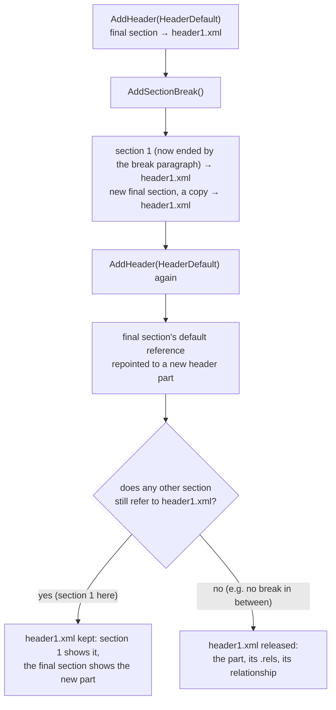

# Word (DOCX)

This guide is the detailed reference for the `docx` package: creating and
modifying Word documents. Reach for it when you need the full feature surface
(styles, tables, tracked changes, comments, footnotes, mail merge, content
controls, fields) or the code walkthroughs for commenting, hyperlinking,
annotating, and adding images and equations to a document. The one-paragraph
quick start lives in the [README](../README.md#creating-a-word-document); this
document carries everything else.

## Common tasks

Open a document, edit its text, add images, links and comments, and save. The
walkthroughs below come first because they are what most programs do; the
topic sections after them cover sections, merging, and text extraction, and
the [capability reference](#capabilities) closes the guide. To add a chart,
see [Charts in Word documents](charts.md#charts-in-word-documents).

### Opening and editing a document

`Open` reads an existing file; edits made afterwards are written back on
`Save`. `Document.ReplaceText` fills placeholders across the body, tables,
and every header and footer.

```go
package main

import (
    "fmt"

    "github.com/mgilbir/spine/docx"
)

func main() {
    doc, err := docx.Open("document.docx")
    if err != nil {
        panic(err)
    }
    defer doc.Close()

    // Read the body paragraph by paragraph.
    for _, p := range doc.Paragraphs() {
        fmt.Println(p.Text())
    }

    // Replace a placeholder wherever it appears; the replacement keeps the
    // formatting of the run it lands in.
    doc.ReplaceText(map[string]string{"{{name}}": "Ada Lovelace"})

    // Edit a core property and append a paragraph.
    doc.Properties.Title = "Updated Title"
    doc.AddParagraphWithText("Added by spine.")

    if err := doc.Save("updated.docx"); err != nil {
        panic(err)
    }
}
```

### Adding images

`Run.AddImage(path)` places an inline image in a run and
`Run.AddFloatingImage(path, anchor)` an anchored one; `AddImageFromBytes` and
`AddFloatingImageFromBytes` take the bytes and a content type instead. PNG,
JPEG, GIF, and SVG are accepted (an SVG gets a transparent raster fallback), and
anything else is rejected when added. A new image is 100×100 pt until you call
`SetSize`, which takes points; an `Anchor` offsets a floating image in points.

```go
package main

import (
    "os"

    "github.com/mgilbir/spine/docx"
)

func main() {
    doc := docx.Create()

    // Inline: the image flows with the text of its run. Sizes are in points.
    img, err := doc.AddParagraph().AddRun().AddImage("logo.png")
    if err != nil {
        panic(err)
    }
    img.SetSize(144, 96)
    img.SetAltText("Company logo")

    // Floating: positioned by an Anchor, in points from the column and
    // paragraph (or from the page with RelativeToPage).
    _, err = doc.AddParagraphWithText("Text beside a floating photo.").
        AddRun().AddFloatingImage("photo.jpg", docx.Anchor{X: 288, Y: 0})
    if err != nil {
        panic(err)
    }

    // From bytes, when the image is not on disk.
    data, err := os.ReadFile("logo.png")
    if err != nil {
        panic(err)
    }
    if _, err := doc.AddParagraph().AddRun().AddImageFromBytes(data, "image/png"); err != nil {
        panic(err)
    }

    if err := doc.Save("images.docx"); err != nil {
        panic(err)
    }
}
```

### Hyperlinks, images, bookmarks, and footnotes

Spine reads and writes hyperlinks, inline and floating images, bookmarks, and
footnotes/endnotes. `docx.Hyperlink` (`URL`, `Anchor`, `Tooltip`) and the image
read accessors use the same method names as their `xlsx` and `pptx`
counterparts; bookmarks and footnotes/endnotes are Word-specific.

```go
package main

import (
    "fmt"

    "github.com/mgilbir/spine/docx"
)

func main() {
    doc, err := docx.Open("document.docx")
    if err != nil {
        panic(err)
    }
    defer doc.Close()

    // Read every hyperlink, image, bookmark, and footnote.
    for _, h := range doc.Hyperlinks() {
        fmt.Printf("link %q -> url=%q anchor=%q\n", h.Text(), h.URL(), h.Anchor())
    }
    for _, img := range doc.Images() {
        fmt.Printf("image %s (%s) %.0fx%.0fpt alt=%q floating=%v\n",
            img.PartName(), img.ContentType(), img.Width(), img.Height(),
            img.AltText(), img.Floating())
    }
    for _, b := range doc.Bookmarks() {
        fmt.Printf("bookmark %q -> %q\n", b.Name(), b.Text())
    }
    for _, f := range doc.Footnotes() {
        fmt.Printf("footnote %s: %s\n", f.ID(), f.Text())
    }

    // Write: an external and an internal hyperlink, a bookmark they can target,
    // and a footnote anchored on a run.
    p := doc.AddParagraph()
    p.AddRun().SetText("See ")
    link := p.AddHyperlink("our site", "https://example.com/")
    link.SetTooltip("Visit us")

    target := doc.AddParagraphWithText("Chapter One")
    target.AddBookmark("chap1")
    doc.AddParagraph().AddInternalHyperlink("go to chapter", "chap1")

    note := doc.AddParagraphWithText("A claim.")
    note.Runs()[0].AddFootnote("Supporting evidence.")

    if err := doc.Save("annotated.docx"); err != nil {
        panic(err)
    }
}
```

External hyperlinks allocate an `External` relationship in the part's rels;
internal ones use `w:anchor`. Adding a footnote or endnote creates
`word/footnotes.xml` / `word/endnotes.xml` (with the mandatory separator notes,
the relationship, and the content-type override) on first use. An open→save
with no edits writes every part of a document using any of these features
byte-identical, and the parts are regenerated only when that feature is
modified.

### Reading and writing comments

Comments support the full review flow: read the feedback on a document, add
comments, reply in threads, and resolve. Add a comment with
`Paragraph.AddComment`, `Run.AddComment`, or `Document.AddCommentOnRange`. The
returned `*docx.Comment` has `ID`, `Author`, `Text`, `Date`, `Resolved`,
`Replies`, `Parent`, `Reply`, and `Resolve`, the same method names the `xlsx`
and `pptx` comment types use; they are three distinct types, each with
format-specific methods too.

```go
package main

import (
    "fmt"

    "github.com/mgilbir/spine/docx"
)

func main() {
    doc, err := docx.Open("document.docx")
    if err != nil {
        panic(err)
    }
    defer doc.Close()

    // Read existing comments and their threads.
    for _, c := range doc.Comments() {
        fmt.Printf("%s on %q: %s (resolved=%v)\n",
            c.Author(), c.AnchorText(), c.Text(), c.Resolved())
        for _, reply := range c.Replies() {
            fmt.Printf("  ↳ %s: %s\n", reply.Author(), reply.Text())
        }
    }

    // Add a comment over a whole paragraph, reply to it, and resolve the thread.
    p := doc.AddParagraphWithText("The quick brown fox.")
    c := p.AddComment("Reviewer", "Please rephrase.")
    reply := c.Reply("Author", "Done.")
    reply.Resolve()

    // Range-precise anchors are also available:
    //   run.AddComment(author, text)
    //   doc.AddCommentOnRange(startRun, endRun, author, text)

    if err := doc.Save("reviewed.docx"); err != nil {
        panic(err)
    }
}
```

Spine writes and round-trips the modern comment parts (`comments.xml`,
`commentsExtended.xml` for threading/resolved state, and `people.xml` for the
author registry) and preserves `commentsIds.xml`/`commentsExtensible.xml`
verbatim. An open→save with no edits writes every part of a comment-bearing
document byte-identical (the zip container around the parts can still differ,
and a part you read follows the
[round-trip fidelity model](architecture.md#round-trip-fidelity-model)).

### Equations

`Paragraph.AddMath` appends an inline math zone (`m:oMath`) and
`Paragraph.AddMathPara` a display equation (`m:oMathPara`). Both take typed
models from `github.com/mgilbir/spine/common/omml`: a zone is an ordered list of
items (runs, fractions, radicals, scripts, and the rest of the OMML set).
`Paragraph.MathZones` and `MathParas` read math back as the same types; they
return snapshots, so write changes back with `AddMath`. `Document.Text()` leaves
math out; use `OMath.Text()` for an equation's plain text.

```go
package main

import (
    "fmt"

    "github.com/mgilbir/spine/common/omml"
    "github.com/mgilbir/spine/docx"
)

// text is a math run holding literal text.
func text(s string) *omml.Run {
    return &omml.Run{Items: []omml.RunChild{&omml.Text{Value: s}}}
}

// arg is a fraction, radical or script argument holding literal text.
func arg(s string) *omml.Element {
    return &omml.Element{Items: []omml.MathItem{text(s)}}
}

func main() {
    doc := docx.Create()

    // Inline math (m:oMath) inside a paragraph of text: x = 1/2.
    p := doc.AddParagraphWithText("Half: ")
    if err := p.AddMath(&omml.OMath{Items: []omml.MathItem{
        text("x="),
        &omml.Fraction{Num: arg("1"), Den: arg("2")},
    }}); err != nil {
        panic(err)
    }

    // A display equation on its own line (m:oMathPara).
    if err := doc.AddParagraph().AddMathPara(&omml.OMathPara{
        OMath: []*omml.OMath{{Items: []omml.MathItem{text("E=m"),
            &omml.Superscript{E: arg("c"), Sup: arg("2")}}}},
    }); err != nil {
        panic(err)
    }

    if err := doc.Save("math.docx"); err != nil {
        panic(err)
    }

    // Read math back: MathZones for inline math, MathParas for display math.
    opened, err := docx.Open("math.docx")
    if err != nil {
        panic(err)
    }
    defer opened.Close()
    for _, para := range opened.Paragraphs() {
        zones, err := para.MathZones()
        if err != nil {
            panic(err)
        }
        for _, z := range zones {
            fmt.Println("inline:", z.Text())
        }
        paras, err := para.MathParas()
        if err != nil {
            panic(err)
        }
        for _, mp := range paras {
            fmt.Println("display:", mp.Text())
        }
    }
}
```

## Headers and footers across sections

`AddHeader` and `AddFooter` act on the document's final section.
`AddSectionBreak` ends that section and starts a new final section that is a
copy of it, header and footer references included, so both sections point at
the same header and footer parts until one of them changes. A section holds at
most one header and one footer of each type (default, first, even), so adding
one of a type the final section already has replaces that reference instead of
adding a second. The part the old reference named is released (the part, its
`.rels`, and its relationship from `document.xml`) only when no other section
still refers to it; otherwise it stays and keeps serving the earlier sections.



Footers follow the same rule. To give an earlier section a header of its own,
add the header before the section break that ends it.

## Merging and appending documents

docx has no split counterpart to pptx's `ExtractSlides`. `Document.Append` appends
another document's body content with its images, remapped styles/numbering
(including numbering preserved as raw XML in an opened source), and the
header/footer parts referenced by the section breaks it copies.

## Text extraction

`docx.Document.Text()` returns plain text with no markup, in a fixed order: the
body in document order (paragraphs incl. hyperlink/inserted-run/content-control
text, and tables cell-by-cell), then each header and footer, then footnotes and
endnotes, then text boxes, including those placed in the body. So a text box's
text comes after the footnotes, not where the box sits in the body.

## Document properties

Core, extended, and custom properties work the same way in all three formats;
see [Document properties](properties.md).

## PNG and SVG physical pages

`docxrender.PreparePage(ctx, document, 1, render.Options{Fonts: resolver})`
prepares a 1-based physical page from the supported bounded paragraph-flow
profile, including unsaved edits. Rendering lives in the separate
`docx/docxrender` package, so importing `docx` alone does not compile the
renderer or its dependencies. See the [rendering guide](rendering.md) for text, page,
font and resource requirements. Unsupported content returns an error; preparation
does not save or synchronize the document.

## Capabilities

### Structure and text

- Create documents from scratch
- Add headings, paragraphs, and tables
- Rich text formatting (bold, italic, color, font, size)
- Paragraph alignment, spacing, and indentation
- Bullet and numbered lists, plus custom numbering definitions via `Document.Numbering()` (per-level format, level text, start, and indent/hanging)
- Style definitions via `Document.Styles()`: create and modify paragraph and character styles (id/name, based-on, next, link, quick-format, and the style's font/size/bold/italic/color, alignment, spacing, and indentation)
- Headers and footers
- Rich run formatting: highlight, super/subscript, caps/small-caps, underline style + color, character spacing/kerning, and paragraph tab stops
- Paragraph borders and shading; run character styles (`Run.SetStyle`) and symbol glyphs (`Run.AddSymbol`)

### Graphics and objects

- Watermarks: text (`SetTextWatermark`) and washed-out image (`SetImageWatermark`) watermarks in the page header, read back with `Watermark()` and cleared with `RemoveWatermark()`; target a specific section with `SetSectionTextWatermark`/`SetSectionImageWatermark` for distinct per-section watermarks, or emit a DrawingML text box (with a VML fallback) via `WatermarkOptions.DrawingML`
- Inline and floating (anchored) images — including SVG images with a raster fallback — see [Adding images](#adding-images)
- Equations: write Office Math with `Paragraph.AddMath`/`AddMathPara` and read it back with `Paragraph.MathZones`/`MathParas` — see [Equations](#equations)
- Text boxes and basic shapes (rectangle, rounded rectangle, ellipse, line), inline or anchored, with fill/border and text as real WordprocessingML paragraphs — `Paragraph.AddTextBox`/`AddShape` and `Document.AddTextBox`/`AddShape`; read every box (DrawingML and legacy VML) back with `Document.TextBoxes()`. Text boxes carry a down-level VML fallback by default (an `mc:AlternateContent` Choice+Fallback pair, so older Word versions still show the box); set `TextBoxOptions.NoVMLFallback` to write the DrawingML shape alone
- WordArt (`Paragraph.AddWordArt`/`Document.AddWordArt`) — a DrawingML text effect with a solid fill and an optional preset text warp (arch, circle, inflate, wave, ...), inline or anchored
- Shape groups (`Paragraph.AddShapeGroup`/`Document.AddShapeGroup`) — several shapes/text boxes combined into one `wpg:wgp` group, each member positioned in the group's coordinate space
- Embedded OLE objects (`Paragraph.AddOLEObject`/`Document.AddOLEObject`) — embed an object stream as a package part with its content type, `oleObject` relationship, a presentation-icon image, and a `w:object` reference declaring the ProgID
- Charts (column, bar, line, pie, doughnut, radar, scatter, area, combo, bubble, stock, surface, pie-of-pie, and 3D variants) inserted inline via `AddChart`, each carrying an embedded workbook so Office can edit the data; read back with `Charts()` — see [charts.md](charts.md)

### Navigation and references

- Fields (PAGE/NUMPAGES) and a table of contents
- Hyperlinks: external and internal (bookmark-anchored) links, read and written through `docx.Hyperlink`, which has the same `URL`/`Anchor`/`Tooltip`/`SetTooltip` methods as the pptx and xlsx `Hyperlink` types plus `Text` and `Runs` (`Document.Hyperlinks`, `Paragraph.AddHyperlink`/`AddInternalHyperlink`)
- Bookmarks: read (`Document.Bookmarks`) and add (`Paragraph.AddBookmark`, `Document.AddBookmarkOnRange`) named bookmarks — the anchors internal hyperlinks target
- Footnotes and endnotes: enumerate (`Document.Footnotes`/`Endnotes`) and author (`Run.AddFootnote`/`AddEndnote`) notes
- Bibliography and citations: read/write bibliography sources (`word/bibliography/sources.xml`, `b:Sources`) with `Document.AddSource`/`Sources()`/`RemoveSource` (tag, type, author, title, year, city, publisher), and cite a source with `Paragraph.AddCitation(tag)`, which emits a `CITATION` field with a formatted placeholder

### Forms, merge, and signatures

- Legacy form fields: enumerate every text/checkbox/dropdown form field (`Document.FormFields()`, walking the body, tables, headers, and footers) with its name, value, checkbox state, and dropdown entries; author new ones with `Paragraph.AddFormField(FormFieldOptions{...})`, which emits the `w:fldChar` begin/separate/end sequence with a `w:ffData` definition. Fields read from a file round-trip byte-identical
- Mail merge: read/write the merge configuration (`Document.MailMerge`/`SetMailMerge`) — main-document type, data source, and `w:odso` field mappings — plus `Paragraph.AddMergeField` and `Document.MergeFields()` for MERGEFIELD fields, and `Document.FillMergeFields` to merge one record (body, headers, footers, footnotes, endnotes and text boxes): each MERGEFIELD becomes its value as plain text, with the `\b`, `\f` and `\*` case switches applied (pair it with `SetMailMerge(nil)` for a finished letter); `FillMergeFieldsWith` adds a value for missing fields (empty or a placeholder), Word's blank-line suppression, and the `\@` date and `\#` number formats (`FormatSwitches`, with `Locale` for the number symbols and month and day names in da/de/en/es/fr/it/nl, `Platform` for Word for Windows or Mac spellings, ISO input or custom parsers)
- Signature lines: insert a visible "Microsoft Office Signature Line" placeholder with `Document.AddSignatureLine`/`Paragraph.AddSignatureLine(SignatureLineOptions{Signer, Title, Email, Instructions})` and read them back with `Document.SignatureLines()` (the in-document signature request, distinct from signing the package with `opc.SignPackage`)

### Sections and page setup

- Page setup (size, margins), multi-column sections, page-number format/start, title-page, and section type; enumerate sections with `Document.Sections()`
- Section depth: page borders, line numbering, vertical alignment, paper source, document grid, and per-section footnote/endnote numbering (position, format, start, restart)
- Document settings: default tab stop, even/odd headers, zoom, document variables (`Document.SetDocumentVariable` and friends), and document-level footnote/endnote numbering defaults (`Document.SetFootnoteProperties`/`SetEndnoteProperties`, complementing the per-section variant)

### Tables

- Table depth: vertical cell merge (`TableCell.SetVerticalMerge`, complementing horizontal `SetGridSpan`), table look/layout/indent/alignment, and read accessors for table and cell borders, width, and shading

### Review, controls, and structure

- Document protection (`Document.Protect`): read-only, comments-only, tracked-changes, or forms editing modes, with an optional password. Protection is a UI guard, not encryption: the password is stored as Word's legacy 16-bit hash, which is obfuscation, not access control, and is trivially removed. To keep a document confidential, encrypt it with `SaveEncrypted` (see [encryption-and-signing.md](encryption-and-signing.md#password-encryption))
- Tracked changes (revisions): enumerate insertions, deletions, run/paragraph property changes, and tracked moves (`w:moveFrom`/`w:moveTo`) — across the main body and every header/footer part — with `Document.Revisions()` (author, date, type, text; `Revision.MoveName` links the two halves of a move), then apply or discard them with `Revision.Accept()`/`Reject()` or `Document.AcceptAllRevisions()`/`RejectAllRevisions()`; author new ones with `Paragraph.AddInsertedRun`, `Run.MarkInserted`, `Run.MarkDeleted`, and `Paragraph.AddMoveFromRun`/`AddMoveToRun` (each assigns a unique `w:id`; `...WithDate` variants pin the timestamp)
- Comments: read and write threaded comments with replies and resolve (`Document.Comments`, `Paragraph.AddComment`, `Document.AddCommentOnRange`, `Comment.Reply`/`Resolve`), through `docx.Comment`, whose core methods have the same names as the pptx and xlsx comment types
- Content controls (structured document tags): read tag, alias, type, value, and drop-down options through `Document.ContentControls()`, and edit the tag, alias, and value (`SetTag`/`SetAlias`/`SetValue`); a control's type and drop-down options are read-only; insert new ones with `Document.AddContentControl` / `Paragraph.AddContentControl` (block-level and inline); bind a control to a custom-XML node with `ContentControl.SetDataBinding(xpath, storeItemID)`
- Document structure parts: read and author building blocks / AutoText in the glossary (`Document.BuildingBlocks()` — name, gallery, category, types, guid — and `Document.AddBuildingBlock(BuildingBlockDef{...})`, which creates the glossary part, its relationship, and content-type override or appends a `w:docPart` to an existing one, preserving the existing entries verbatim), read and add custom-XML data parts (`Document.CustomXMLParts()` / `Document.AddCustomXMLPart` — the latter generates the itemProps, relationships, and content-type override), and read and author the web-layout frameset tree (`Document.Frameset()` and `Document.SetFrameset(FramesetDef{...})` — nested framesets and leaf frames with their source documents, wired as external frame relationships). Glossary, custom-XML, and frameset parts round-trip byte-for-byte when untouched; an authored building block's body is a placeholder paragraph (the API models building-block metadata, not body content)
- Theme read/write (`Document.Theme()`): color-scheme accents and major/minor Latin fonts, sharing the `dml.ThemeEditor` model with the xlsx and pptx theme APIs
- Search & replace (`Document.ReplaceText`, mirroring `pptx` and `xlsx`): replaces across the body, tables, structured document tags, and every header/footer, including matches Word has split across multiple `w:r` runs — the replacement inherits the first affected run's formatting while surrounding runs keep theirs; documents with no matching text round-trip byte-for-byte
