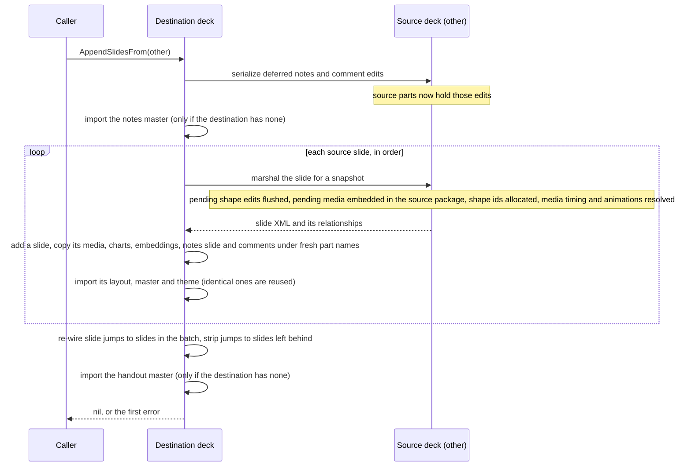

# PowerPoint (PPTX)

This guide is the detailed reference for the `pptx` package: creating and
modifying PowerPoint presentations. Reach for it when you need the full feature
surface (shapes, tables, charts, animations, transitions, SmartArt, comments,
sections, embedded media) or the code walkthroughs for opening, templating,
commenting, and hyperlinking a deck, and for adding pictures, tables, and
placeholder text to it. The one-paragraph quick start lives in the
[README](../README.md#creating-a-powerpoint-presentation); this document carries
everything else.

## Common tasks

Open a deck, fill its slides, add pictures and tables, and save. The
walkthroughs below come first because they are what most programs do; the
topic sections after them cover layouts, merging, and text extraction, and the
[capability reference](#capabilities) closes the guide. To add a chart, see
[Charts in PowerPoint](charts.md#charts-in-powerpoint).

### Opening and modifying a presentation

```go
package main

import (
    "github.com/mgilbir/spine/pptx"
)

func main() {
    // Open an existing presentation
    p, err := pptx.Open("existing.pptx")
    if err != nil {
        panic(err)
    }
    defer p.Close()

    // Modify properties
    p.Properties.Title = "Updated Title"

    // Add a new slide
    p.AddSlide()

    // Save to a new file
    if err := p.Save("modified.pptx"); err != nil {
        panic(err)
    }
}
```

### Creating from a template

```go
package main

import (
    "github.com/mgilbir/spine/pptx"
)

func main() {
    // Create a new presentation based on a template
    // This preserves the template's masters, layouts, and themes
    p, err := pptx.CreateFromTemplate("template.pptx")
    if err != nil {
        panic(err)
    }
    defer p.Close()

    // Add slides using template layouts. LayoutByType reports a template
    // without that layout as pptx.ErrLayoutNotFound.
    layout, err := p.LayoutByType(pptx.LayoutTitleAndContent)
    if err != nil {
        panic(err)
    }
    _ = p.AddSlideFromLayout(layout)

    // Save the new presentation
    if err := p.Save("from_template.pptx"); err != nil {
        panic(err)
    }
}
```

### Filling placeholders

`Slide.Placeholders()` lists a slide's placeholder shapes; `SetText` replaces a
placeholder's text. `Slide.TitlePlaceholder()` finds the title, including a
title slide's centered title (`ctrTitle`), and `Slide.BodyPlaceholder()` the
body or content placeholder, including one written with no type attribute,
the usual form on a "Title and Content" slide (the schema reads a missing
type as `obj`). Each prefers the exact `title` or `body` type when a slide has
both forms. `PlaceholderShape.IsTitle()` and `IsBody()` test the same
categories on a single placeholder.

A slide added with `AddSlideFromLayout` uses the layout's design but has no
placeholder shapes of its own. Add the ones you want with
`DefaultTitlePlaceholder`, `DefaultBodyPlaceholder` or `NewPlaceholderShape`.

```go
package main

import (
    "github.com/mgilbir/spine/pptx"
)

func main() {
    p, err := pptx.Open("deck.pptx")
    if err != nil {
        panic(err)
    }
    defer p.Close()

    // Fill the placeholders a slide already has.
    slide, err := p.Slide(0)
    if err != nil {
        panic(err)
    }
    for _, ph := range slide.Placeholders() {
        switch {
        case ph.IsTitle(): // title or centered title
            ph.SetText("Quarterly review")
        case ph.IsBody(): // body, content, or a placeholder with no type
            ph.SetText("Agenda")
        }
    }

    // A slide added from a layout has no placeholder shapes of its own:
    // add the ones you want to fill.
    layout, err := p.LayoutByType(pptx.LayoutTitleOnly)
    if err != nil {
        panic(err)
    }
    next := p.AddSlideFromLayout(layout)
    title := pptx.DefaultTitlePlaceholder()
    title.SetText("Next steps")
    if err := next.AddShape(title); err != nil {
        panic(err)
    }

    if err := p.Save("filled.pptx"); err != nil {
        panic(err)
    }
}
```

### Adding pictures

`Slide.AddPicture(path)` reads an image file and `Slide.AddPictureFromBytes(data,
contentType)` takes the bytes; both embed the image as a media part on save and
reject data that is not an image format the package embeds. An SVG is embedded
with a transparent raster fallback. The frame starts at the image's pixel size at
96 DPI (4×3 inches when the size cannot be decoded); `SetPosition`/`SetSize`
place it, in EMUs. Crops are fractions of the image trimmed from each edge.

```go
package main

import (
    "os"

    "github.com/mgilbir/spine/common/dml"
    "github.com/mgilbir/spine/pptx"
)

func main() {
    p := pptx.Create()
    slide := p.AddSlide()

    // From a file. The frame starts at the image's pixel size at 96 DPI.
    logo, err := slide.AddPicture("logo.png")
    if err != nil {
        panic(err)
    }
    logo.SetPosition(dml.Inches(0.5), dml.Inches(0.5))
    logo.SetAltText("Company logo")

    // From bytes, sized explicitly and cropped: crops are fractions of the
    // image (0.0 to 1.0) trimmed from the left, top, right and bottom edges.
    data, err := os.ReadFile("photo.jpg")
    if err != nil {
        panic(err)
    }
    photo, err := slide.AddPictureFromBytes(data, "image/jpeg")
    if err != nil {
        panic(err)
    }
    photo.SetPosition(dml.Inches(3), dml.Inches(1))
    photo.SetSize(dml.Inches(4), dml.Inches(3))
    photo.SetCrop(0.1, 0, 0.1, 0)

    if err := p.Save("pictures.pptx"); err != nil {
        panic(err)
    }
}
```

### Editing tables

`Slide.AddTable(rows, cols)` returns a `*Table`. On an opened slide, find a
table among `Slide.Shapes()` with a `*pptx.Table` type assertion. Edits to a
table loaded from a file are flushed into the slide on save; `Table.SyncXML`
only flushes them earlier.

```go
package main

import (
    "github.com/mgilbir/spine/common/dml"
    "github.com/mgilbir/spine/pptx"
)

func main() {
    p := pptx.Create()
    slide := p.AddSlide()

    tbl := slide.AddTable(3, 2)
    tbl.Cell(0, 1).SetText("Q1")
    tbl.Cell(1, 0).SetText("North")
    tbl.Cell(2, 0).SetText("South")

    // Rows: append, insert before an index, delete.
    tbl.AddRow().Cells()[0].SetText("Total")
    tbl.InsertRow(1).Cells()[0].SetText("East")
    tbl.DeleteRow(2) // drops "North"

    // Columns: append one with a width, or copy an existing column (styling
    // and text) into a position, since there is no InsertColumn. Delete by index.
    tbl.AddColumn(dml.Inches(1.5))
    tbl.CloneColumn(1, 2)
    tbl.Cell(0, 2).SetText("Q2")
    tbl.DeleteColumn(3)

    // Merge: a cell spans the cells to its right (SetColSpan) or below it
    // (SetRowSpan); the cells it covers are marked as continuations on save.
    // Merge last: cloning or deleting across a merge is left to you.
    tbl.Cell(3, 0).SetColSpan(2)

    if err := p.Save("table.pptx"); err != nil {
        panic(err)
    }
}
```

### Hyperlinks and pictures

Hyperlinks are read and written through `*pptx.Hyperlink` (`URL`, `Anchor`,
`Tooltip`, `SetTooltip`). The `docx` and `xlsx` packages have their own
`Hyperlink` types with the same method names plus format-specific ones. In pptx
a link lives on a run (`a:hlinkClick` in the run properties) or on a shape
(`p:cNvPr`); the anchor of an internal link is a destination slide number (a
slide jump) or a `ppaction://` verb. `Slide.Pictures()` returns every picture on
a slide with its alt text, bytes, content type, and frame geometry.

```go
package main

import (
    "fmt"

    "github.com/mgilbir/spine/common/dml"
    "github.com/mgilbir/spine/pptx"
)

func main() {
    p, err := pptx.Open("deck.pptx")
    if err != nil {
        panic(err)
    }
    defer p.Close()

    // Read: every hyperlink and every picture across the deck.
    for _, h := range p.Hyperlinks() {
        fmt.Printf("url=%q anchor=%q tip=%q\n", h.URL(), h.Anchor(), h.Tooltip())
    }
    for _, pic := range p.Pictures() {
        fmt.Printf("%s %s (%d bytes)\n", pic.AltText(), pic.ContentType(), len(pic.Data()))
    }

    // Write: an external link on a run, an internal slide jump on a shape.
    slide, err := p.Slide(0)
    if err != nil {
        panic(err)
    }
    run := slide.AddTextBox().TextFrame().AddParagraph().AddRun()
    run.SetText("Our site")
    run.SetHyperlink("https://example.com").SetTooltip("Open the site")

    shape := pptx.NewAutoShape(pptx.PresetRect)
    shape.SetSize(914400, 914400)
    if err := slide.AddShape(shape); err != nil {
        panic(err)
    }
    shape.SetHyperlinkToSlide(2)              // jump to slide 3 (0-based index)
    // shape.SetActionHyperlink(pptx.ActionNextSlide) // or a ppaction:// verb

    // Connect two shapes with an elbow connector (ids are bound on save).
    other := pptx.NewAutoShape(pptx.PresetEllipse)
    if err := slide.AddShape(other); err != nil {
        panic(err)
    }
    conn := slide.AddConnector(pptx.ConnectorElbow)
    conn.Connect(shape, 3, other, 1)          // bind start/end to connection sites
    conn.SetLineWidth(2)
    conn.SetLineColor(dml.NewRGB(0xC0, 0x00, 0x00).ToColor())
    // Or draw a free-floating line between two points:
    // conn := slide.AddConnector(pptx.ConnectorStraight)
    // conn.SetPoints(0, 0, dml.Inches(3), dml.Inches(2))

    if err := p.Save("linked.pptx"); err != nil {
        panic(err)
    }
}
```

Writing an external or slide-jump link allocates the backing relationship in the
slide's rels on save; `ppaction://` verbs need none. An open→save with no edits
writes every part of a hyperlink- or picture-bearing deck byte-identical, and
setting a hyperlink on a run in an opened slide patches that slide in place
without disturbing the others.

`SetHyperlinkToSlide` takes a 0-based slide index that is only resolved at save
time — the target slide may not exist yet when you set the link. If the index is
still out of range for the deck when it is saved, **no hyperlink is emitted at
all**: the alternative is a `ppaction://hlinksldjump` with no target, which is a
dangling action PowerPoint may reject. The call itself returns a `*Hyperlink`
either way and reports no error, so validate the index yourself against
`Presentation.SlideCount()` if a silently absent link would be a problem.

### Reading and writing slide comments

`pptx` reads both PowerPoint comment mechanisms — legacy per-slide comments and
modern (2018) threaded comments — through one `*Comment` type, and writes modern
threaded comments (the mechanism current PowerPoint emits, and the only one that
supports replies and resolution). The API mirrors the `docx` and `xlsx` comment
APIs; the anchor (a slide plus an optional position or shape) is pptx-specific.

```go
package main

import (
    "fmt"

    "github.com/mgilbir/spine/pptx"
)

func main() {
    p, err := pptx.Open("deck.pptx")
    if err != nil {
        panic(err)
    }
    defer p.Close()

    // Read every comment across the deck.
    for _, c := range p.Comments() {
        fmt.Printf("%s: %s\n", c.Author(), c.Text())
        for _, reply := range c.Replies() {
            fmt.Printf("  ↳ %s: %s\n", reply.Author(), reply.Text())
        }
    }

    // Add a threaded comment, reply to it, and resolve it. The author is
    // registered in the author list (deduplicated by name).
    slide, _ := p.Slide(0)
    c := slide.AddComment("Reviewer", "Please tighten this section.")
    c.Reply("Author", "Done in the next revision.")
    c.Resolve()

    // Precise placement (EMUs) is available via AddCommentAt.
    slide.AddCommentAt(4572000, 2286000, "Reviewer", "Anchored here.")

    if err := p.Save("deck.pptx"); err != nil {
        panic(err)
    }
}
```

Newly added comments always use the modern threaded mechanism, even on a deck
whose existing comments are legacy (both may coexist in one file). Legacy
comments carry no threading or resolved state, so `Reply` is a no-op returning
`nil` and `Resolve`/`SetResolved` are no-ops on them. An open→save with no
edits writes every part of a comment-bearing deck byte-identical (the zip
container around the parts can still differ, and a part you read follows the
[round-trip fidelity model](architecture.md#round-trip-fidelity-model)); a
comment write regenerates only the parts it touches.

## Slide layouts

The following standard slide layout types are supported:

| Type | Description |
|------|-------------|
| `LayoutTitle` | Title slide |
| `LayoutTitleAndContent` | Title and content |
| `LayoutSectionHeader` | Section header |
| `LayoutTwoContent` | Two content areas |
| `LayoutComparison` | Comparison layout |
| `LayoutTitleOnly` | Title only |
| `LayoutBlank` | Blank slide |
| `LayoutContentWithCaption` | Content with caption |
| `LayoutPictureWithCaption` | Picture with caption |
| `LayoutTitleAndVerticalText` | Title and vertical text |
| `LayoutVerticalTitleAndText` | Vertical title and text |

The exact `Layout*` constant names are the source of truth in [`pptx/layout.go`](../pptx/layout.go).

## Merging and splitting decks

Combine decks or split slides out into a new one.
`Presentation.AppendSlidesFrom` / `Presentation.ExtractSlides` copy slides and
their media/charts/embeddings between decks, carrying each slide's own layout, master, theme (deduplicating
identical masters/layouts), notes slide, and the source deck's notes master and
handout master (when the destination has none).

**`AppendSlidesFrom` may modify the source deck.** To take an authoritative
snapshot it marshals each of the source's slides, and marshaling is what flushes
a slide's pending edits: shape ids are allocated, pending media (images, audio,
video) is embedded into the *source* package, and media timing and animations
are resolved. The copy taken into the destination is fully independent, but a
caller that keeps using `other` afterwards — or saves it — will see a source
whose in-memory model reflects those flushed edits. If the source must stay
pristine, open it again from disk rather than reusing the handle.

The sequence below is what one `AppendSlidesFrom` call does, in order. The
steps that land on the source deck are the ones a caller reusing `other` will
see.



## Text extraction

`pptx.Presentation.Text()` / `Slide.Text()` return all shapes incl. groups and
tables, plus speaker notes and comments — plain concatenation, no markup,
deterministic ordering.

## Embedded OLE objects

OLE objects are read and embedded in all three formats; see
[Embedded OLE objects](forms-and-objects.md#embedded-ole-objects).

## Ink annotations and 3D models

Ink and 3D models are read the same way in pptx and docx; see
[Ink annotations and 3D models](forms-and-objects.md#ink-annotations-and-3d-models).

## PNG and SVG slides

`pptxrender.PrepareSlide(ctx, slide, opts)` prepares the supported static
geometry/image/plain-text profile for native PNG or SVG output, including
unsaved edits. Rendering lives in the separate `pptx/pptxrender` package, so
importing `pptx` alone does not compile the renderer or its dependencies. See the [rendering
guide](rendering.md) for the strict capability matrix and resource contracts.
Unsupported text styles and visible content return errors; rendering does not save or
synchronize source parts.

## Capabilities

### Slides and structure

- Create presentations from scratch or from templates
- Add, remove, reorder, and duplicate slides (`Slide.Duplicate` deep-copies the slide's shapes, slide-level relationships, notes slide, and any generated auto-play/animation timing into a new slide)
- Slide sections (the thumbnail-pane groups): read (`Presentation.Sections()`), create (`AddSection`), and assign slides (`Section.AddSlide` / `Presentation.MoveSlideToSection`), stored in the `p14:sectionLst` extension
- Zoom objects (Slide, Section, and Summary zooms) — read (`Slide.ZoomLinks`/`Presentation.ZoomLinks`): each zoom's kind, hosting shape, and target slide id or section GUID(s); zoom frames round-trip byte-for-byte. Creating a zoom is not supported (a zoom embeds a rendered thumbnail image of its target that the library cannot generate)

### Shapes, text, and tables

- Add shapes, text, tables, and images — including SVG images with a raster fallback
- Slide placeholders, and access to each master and layout: read-only placeholders, plus theme read/write through `Presentation.Theme()` / `SlideMaster.Theme()`, which return the same `dml.ThemeEditor` the docx and xlsx theme APIs use
- Auto shapes with solid/gradient fills, lines, and shadows; `AutoShape.SetNoLine()` explicitly removes the outline while preserving other source line metadata
- Connectors (`Slide.AddConnector`/`Slide.Connectors`, and `GroupShape.AddConnector`/`GroupShape.Connectors` inside a group): straight, elbow, and curved connection shapes bound to two shapes' connection sites (ids resolved on save) or drawn between free points, with line width/color/dash; an open→save keeps the parts of a deck with existing connectors byte-identical
- Shape effects on auto shapes and text boxes — glow (`SetGlow`/`Glow`), reflection (`SetReflection`), soft edge (`SetSoftEdge`), and a basic 3D bevel (`SetBevel`), each read back and written to `a:effectLst`/`a:sp3d`
- Slide, master, and layout background fills (`SetBackgroundFill`/`BackgroundColor`/`HasBackground`/`ClearBackground`), reusing the shared `dml.Fill` (solid, gradient, or pattern), plus image (blip) backgrounds (`SetBackgroundImage(data, contentType)`) that embed a media part and stretch it behind the slide/layout/master
- Table styling: built-in/theme table-style reference (`Table.SetStyleID`) and per-cell text insets (`TableCell.SetMargins`)
- Rich text depth: text-frame autofit, auto-numbered bullets with bullet color/size/font, and paragraph indent/tab stops
- Read every picture on a slide (`Slide.Pictures()`), with alt text, bytes, content type, and position/size; add pictures with `Slide.AddPicture`/`AddPictureFromBytes` and crop them — see [Adding pictures](#adding-pictures)
- Charts (column, bar, line, pie, doughnut, radar, scatter, area, combo, bubble, stock, surface, pie-of-pie, and 3D variants) placed on a slide with `Slide.AddChart`, each carrying an embedded workbook so Office can edit the data; read back with `Slide.Charts()` — see [charts.md](charts.md#charts-in-powerpoint)

### Slide furniture

- Slide furniture: footers, auto-updating or fixed dates, and slide numbers on every slide
- Read the presentation's footer, slide-number, and date furniture set on slides

### Embedded media

- Embedded video and audio (`Slide.AddVideo`/`AddAudio`): store the clip as a `/ppt/media` part wired by both a Microsoft `media` embed and an OOXML video/audio link relationship, with a generated poster preview; media plays on click by default, and `SetPlayMode(PlayAutomatically)` generates the autoplay timing tree. An omitted content type is sniffed from the data

### Masters, layouts, and fonts

- Slide master / layout editing: per-level master text styles (`SlideMaster.TitleStyle`/`BodyStyle`/`OtherStyle` with `SetLevelFont`/`SetLevelFontSize`/`SetLevelBold`/`SetLevelItalic`/`SetLevelColor`/`SetLevelBullet`, including adding a level absent from the source in correct schema order), master/layout placeholder geometry (`EditablePlaceholders`/`EditablePlaceholder` with `SetPosition`/`SetSize`), and adding a layout under a master (`SlideMaster.AddLayout`) — unedited masters and layouts round-trip byte-for-byte and an edit touches only its own part
- Embedded fonts (`Presentation.EmbeddedFonts`/`SetEmbeddedFonts` to reference existing font parts, `EmbedFont(name, regular, bold, italic, boldItalic)` to create the font-data parts and relationships from raw bytes) and custom slide shows (`Presentation.CustomShows`/`AddCustomShow`), read and written

### Transitions and animations

- Slide transitions (fade, push, wipe, circle, comb, newsflash, pull, random-bar, strips, wedge, zoom, and more) with direction/orientation, wheel spokes, through-black, and sound actions — a stop-previous action and a start sound authored from raw audio bytes (`TransitionSound.StartSoundData`) or read back from a file; the PowerPoint 2016+ **morph** transition (`TransitionMorph` with `MorphOption` for object/word/character morphing), written as the `p159:morph` extension wrapped in `mc:AlternateContent` with a fade fallback and read back through `Transition()`
- Slide animations: entrance (appear, fade, fly-in, wipe, zoom), emphasis (pulse, spin, grow/shrink), and exit (disappear, fade, fly-out) effects with on-click / with-previous / after-previous sequencing and optional build-by-paragraph, authored via `Slide.AddAnimation` and read back with `Slide.Animations()`

### SmartArt and diagrams

- Read SmartArt / diagrams (`Slide.SmartArt()` / `Presentation.SmartArt()`): each graphic's text nodes and their hierarchy from the diagram data part (`dgm:dataModel`), returned as a `SmartArtNode` tree via `SmartArt.Nodes()`; the raw diagram parts round-trip byte-for-byte
- Create SmartArt (`Slide.AddSmartArt(kind, nodes...)`) for the list (`SmartArtList`), hierarchy/org-chart (`SmartArtHierarchy`), left-to-right process (`SmartArtProcess`), and radial cycle (`SmartArtCycle`) kinds: generates all four definition parts (`dgm:dataModel`/`layoutDef`/`styleDef`/`colorsDef`), the content-type overrides, slide relationships, and the `dgm:relIds` graphicFrame so Office renders the diagram; returns a `SmartArt` whose `Nodes()` reads the outline back

### Notes, comments, hyperlinks, and search

- Speaker notes: read (`Slide.Notes()`) and write (`Slide.SetNotes`) the notes-slide body text; editing rewrites only the affected notes part while untouched notes slides round-trip byte-for-byte
- Comments: read both legacy per-slide comments and modern threaded comments, and write threaded comments with replies and resolve (`Presentation.Comments`, `Slide.AddComment`/`AddCommentAt`, `Comment.Reply`/`Resolve`), through `pptx.Comment`, whose core methods (`Author`, `Text`, `Replies`, `Reply`, `Resolve`) have the same names as the docx and xlsx comment types
- Hyperlinks on runs and shapes (external URLs, internal slide jumps, and `ppaction://` verbs), read and written through `pptx.Hyperlink` (`URL`, `Anchor`, `Tooltip`, `SetTooltip`: the same method names as the docx and xlsx `Hyperlink` types, which are distinct types)
- Search & replace (`Presentation.ReplaceText` / `Slide.ReplaceText` / `Slide.ReplaceTextInShape`, mirroring `docx` and `xlsx`): exact-match replacement across shapes, table cells, and nested groups — including matches split across multiple runs — rewriting the XML in place to preserve formatting; speaker notes are not touched
