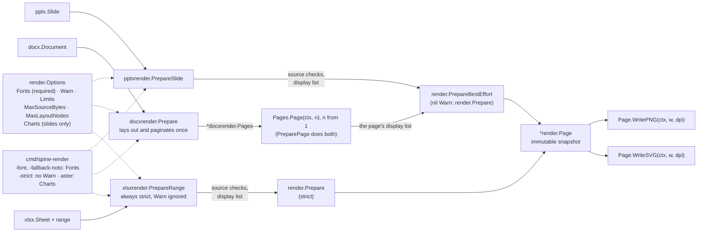
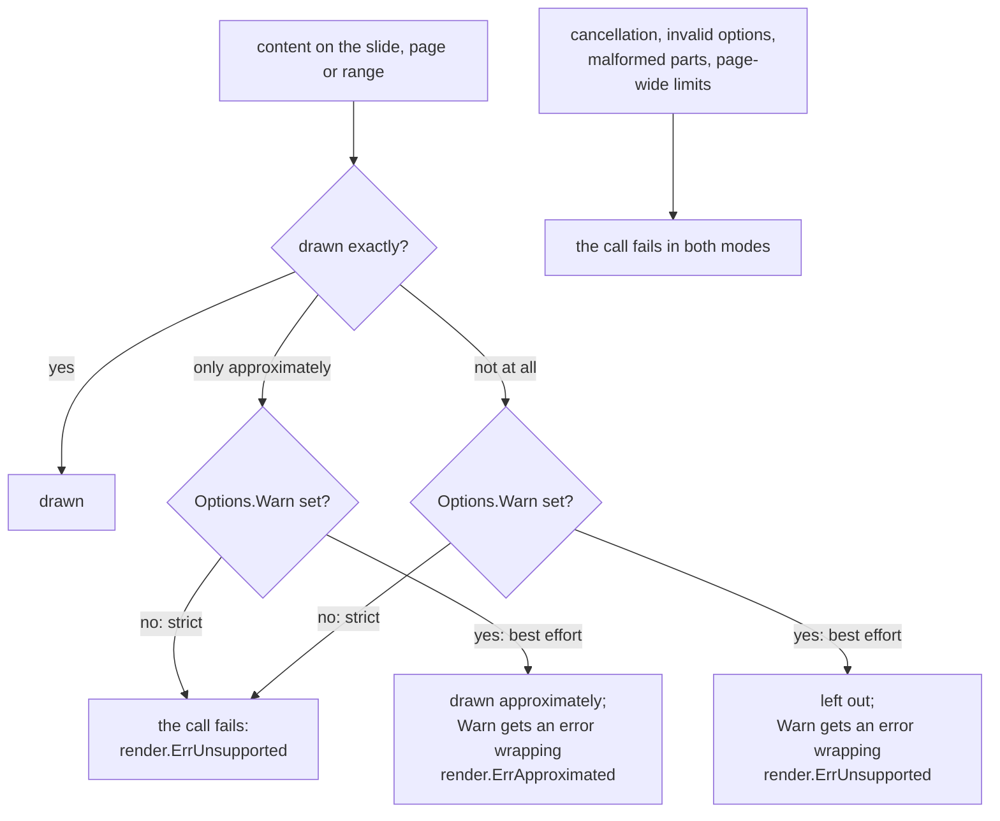

# Native rendering

spine draws PowerPoint slides, the physical pages of a Word document, and Excel
cell ranges as PNG or SVG, in pure Go, with no browser, office suite or external
process. Use it for thumbnails, previews and visual diffs. Each format has its
own entry point, and all of them produce a `render.Page` that writes PNG or SVG:

| To draw | Call | Package |
|---|---|---|
| one slide | `pptxrender.PrepareSlide(ctx, slide, opts)` | `pptx/pptxrender` |
| the pages of a Word document | `docxrender.Prepare(ctx, doc, opts)`, then `Pages.Page(ctx, n)` with `n` counted from 1 (or `docxrender.PreparePage` for a single page) | `docx/docxrender` |
| a cell range | `xlsxrender.PrepareRange(ctx, sheet, "A1:D20", opts)` | `xlsx/xlsxrender` |

Rendering shipped in 0.4.0. The format packages do not import it, so a program
that only reads and writes documents does not link the renderer.

The call you make, and where fonts, warnings and limits enter:



## Quick start

Render the third slide of a deck to a 144 DPI PNG:

```go
package main

import (
    "context"
    "fmt"
    "log"
    "os"

    "github.com/mgilbir/forme/fonts/notosans"
    "github.com/mgilbir/forme/shape"
    "github.com/mgilbir/spine/pptx"
    "github.com/mgilbir/spine/pptx/pptxrender"
    "github.com/mgilbir/spine/render"
)

func main() {
    ctx := context.Background()

    p, err := pptx.Open("deck.pptx")
    if err != nil {
        log.Fatal(err)
    }
    defer p.Close()

    // Every font the slide asks for is answered with the bundled Noto Sans.
    // Map the deck's real fonts here (shape.Load on the font file) for
    // faithful text.
    noto, err := notosans.Face()
    if err != nil {
        log.Fatal(err)
    }
    opts := render.Options{
        Fonts: func(ctx context.Context, req render.FontRequest) (*shape.Face, error) {
            return noto, nil
        },
        // Best effort: draw what can be drawn and report the rest.
        // Leave Warn nil to fail on anything not drawn exactly.
        Warn: func(err error) { log.Println("warning:", err) },
    }

    page, err := pptxrender.PrepareSlide(ctx, p.Slides()[2], opts) // slide 3
    if err != nil {
        log.Fatal(err)
    }

    out, err := os.Create("slide-3.png")
    if err != nil {
        log.Fatal(err)
    }
    defer out.Close()
    if err := page.WritePNG(ctx, out, 144); err != nil { // 144 DPI
        log.Fatal(err)
    }
    fmt.Println(page.Size(144))
}
```

Two things in `render.Options` decide most outcomes:

- **`Fonts`** is required. spine never looks up host fonts: every family the
  document names is requested from your resolver as a `render.FontRequest`.
  Map them to font files with `shape.Load` (from
  `github.com/mgilbir/forme/shape`), or answer every request with the bundled
  Noto Sans as above. Text drawn in a substitute font is laid out with that
  font's metrics, so it will not match Office line for line. A resolver that
  fails (or answers nil) makes preparation fail with an error wrapping
  `render.ErrUnsupported` — a resolver failure is a configuration matter, not
  a document defect — with the resolver's own error preserved in the chain
  (`render.FontResolverError`); cancellation still wins, and `ErrLimit` and
  `ErrInvalid` from the resolver pass through untouched. The metafile paths
  are the exception: missing text faces are left out and reported through
  `Warn` (or strict preparation) instead of failing the call.
- **`Warn`** selects the mode. Left nil, the call is *strict*: anything that
  cannot be drawn exactly fails it with `render.ErrUnsupported`. Set, the call
  is *best effort*: the rest is drawn and the problems are reported to `Warn`,
  each as an error wrapping `render.ErrUnsupported` (left out) or `render.ErrApproximated`
  (drawn approximately). XLSX range previews are always strict.

From the command line, the same render for every slide is:

```sh
go build ./cmd/spine-render
./spine-render -input deck.pptx -out previews -fallback-noto
```

`examples/render_previews` renders a slide, a sheet range and two Word pages,
to both formats. The rest is reference, one page each: the painter and its
limits, then what each format draws, approximates and leaves out, then the
[command line](rendering/cli.md) and [measuring fidelity](rendering/fidelity.md).

## Strict and best effort

`render.Options.Warn` chooses between the two modes. The format pages say
what falls on each side: [slides](rendering/pptx.md#strict-and-best-effort),
[Word pages](rendering/docx.md#how-a-document-is-drawn) and
[sheet ranges](rendering/xlsx.md).



The exceptions:

- `xlsxrender` ignores `Warn`: sheet ranges are always strict.
- A color glyph a Word page approximates is reported once per kind per page,
  by `Pages.Page`, which may call `Warn` concurrently when pages are prepared
  concurrently ([Color fonts](rendering/painter.md#color-fonts)).
- Slides report what they approximate once per shape; Word documents
  report each kind of problem once.
- Some slide warnings for approximated content wrap `render.ErrUnsupported`
  as well, so test `render.ErrApproximated` first.
- `spine-render` is best effort by default; `-strict` leaves `Warn` unset
  ([command line](rendering/cli.md#best-effort-and-strict)).

## Where to find what

- [Command line](rendering/cli.md): `spine-render` flags, fonts, exit statuses,
  errors, and the runnable previews example.
- [Limits](rendering/limits.md): every `render.Limits` field and default,
  the source budgets, and the DOCX budgets.
- [The painter](rendering/painter.md): the display list, antialiasing,
  image sampling, cancellation, and color fonts.
- [PowerPoint slides](rendering/pptx.md): the static slide profile and charts.
- [Word pages](rendering/docx.md): the physical-page profile and pagination.
- [Excel ranges](rendering/xlsx.md): the sheet range profile.
- [EMF and WMF pictures](rendering/metafiles.md): metafile playback, shared by
  slides and Word pages.
- [Measuring fidelity](rendering/fidelity.md): comparing renders with
  PowerPoint or LibreOffice output.
- [The design plan](design/png-rendering-plan.md): the historical note
  rendering was built from.
