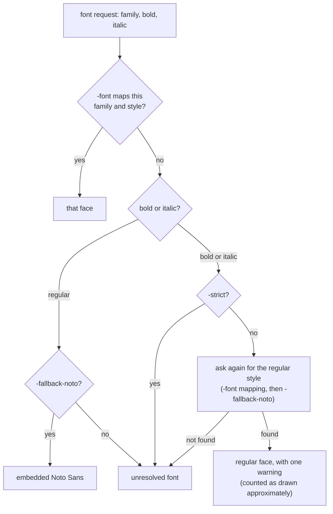

# spine-render: rendering from the command line

This page is the reference for `cmd/spine-render`, which renders every
slide, page or sheet range of a file to PNG or SVG: its flags, font
mapping, budgets, strict and best-effort behavior, exit statuses and
errors, and the runnable previews example. It is for users who render
from a shell or a build pipeline rather than from Go.
It is part of the [rendering guide](../rendering.md), which has the quick
start and the entry points.

Build `go build -o spine-render ./cmd/spine-render`, then supply an input file and
output directory. PNG is the default; `-format both` also writes SVG.

```sh
./spine-render -input deck.pptx -out previews -font 'Calibri=fonts/Calibri.ttf'
./spine-render -input report.docx -out previews -format both -font 'Calibri=fonts/Calibri.ttf'
./spine-render -input workbook.xlsx -out previews -range A1:D20 -sheet Data -font 'Calibri=fonts/Calibri.ttf'
```

The input's format is chosen by its extension, matched without regard to
case: `.pptx`, `.docx` or `.xlsx`.
Other members of the families the libraries open, such as `.pptm`, `.potx`,
`.docm`, `.dotx`, `.xlsm` and `.xltx`, are refused by name before the file is
read.

PPTX renders every slide. DOCX renders every physical page, with 1-based output
names. XLSX requires an explicit range to bound its canvas; the range applies to
all sheets unless `-sheet` selects one by exact name. Sheet filenames use their
original 1-based workbook indices, avoiding unsafe names from source content.
Outputs are named `slide-0001`, `page-0001` and `sheet-0001`, with `.png` or
`.svg`.

## Flags

| Flag | Default | Meaning |
|---|---|---|
| `-input` | (required) | The `.pptx`, `.docx` or `.xlsx` file. |
| `-out` | (required) | Output directory, created if missing. Existing files in it are never overwritten. |
| `-format` | `png` | `png`, `svg` or `both`. |
| `-range` | (required for XLSX) | Cell range drawn from each selected sheet, such as `A1:D20`. Refused for PPTX and DOCX. |
| `-sheet` | every sheet | XLSX sheet to draw, by exact name. Refused for PPTX and DOCX. |
| `-dpi` | 288 | Output resolution; positive and finite. |
| `-max-pages` | 100 | Total slides, pages or sheets written, 1 to 10000. |
| `-edge-checks` | 0, meaning 4 Gi | Path painting budget per output (`Limits.MaxEdgeChecks`). |
| `-image-pixels` | 0, meaning 64 Mi | Decoded image pixels per slide, page or sheet (`Limits.MaxImagePixels`). |
| `-shape-work` | 0, meaning 64 Mi | Shaping work per slide, page or sheet (`Limits.MaxShapeWork`). |
| `-timeout` | `1m` | Bound on the whole run; must be positive. |
| `-font` | none | Repeatable `FAMILY[:regular\|bold\|italic\|bolditalic]=FILE[#FACE]` mapping; at most 32. |
| `-fallback-noto` | false | Answer unresolved regular fonts with the embedded Noto Sans. |
| `-strict` | false | Fail on content that cannot be drawn exactly, instead of best effort (PPTX and DOCX). |
| `-keep-going` | false | Report and skip what cannot be prepared, render the rest, then exit 1. |
| `-charts` | true | Draw PPTX charts with aster; `-charts=false` leaves them out with a warning. |
| `-help` | | Print the flags and exit 0. |

Negative budgets are refused; 0 selects the default shown.

## Fonts

Repeat `-font` for additional families or styles, e.g.
`-font 'Calibri:bold=fonts/Calibri-Bold.ttf'`. Files are loaded explicitly through
Forme, with at most 32 mappings and 32 MiB aggregate font input. No host fonts
are searched.

A TrueType or OpenType collection (`.ttc`, `.otc`, or one wrapped as WOFF 2)
holds several fonts in one file, and a mapping picks one of its faces by its
index from zero after a `#`: `-font 'Cambria=fonts/cambria.ttc#0'`,
`-font 'Cambria Math=fonts/cambria.ttc#1'`. The index is the digits after the
last `#` of the file name; a file whose own name ends in `#` and digits takes
an index of its own as well (`a#12` is `a#12#0`), and other `#`s are part of
the name. A mapping to a collection of several faces without an index fails,
naming the first eight faces with their indices, family and style, and
PostScript names, so that the face is never a guess; a single font, or a
collection of one face, loads without one, and an index past its faces fails.
Several faces mapped from one file read and count it once toward the 32 MiB
(it is found by its cleaned path; two paths to one file count twice). Faces
load at their default instance, and share the file's bytes. Charts take one
font per file, so for a chart each mapped face of a collection is copied out
into a font of its own, which together may hold up to a further 32 MiB (the
tables the faces share are copied for each); past that, and only when charts
are drawn, the command fails and `-charts=false` leaves them out. `-fallback-noto` explicitly substitutes embedded Noto Sans for
unresolved regular faces. Strict, bold and italic faces require mappings;
otherwise a missing bold or italic face is drawn with the family's regular
face, or the regular fallback, with a warning. Substitution can
change wrapping and overflow.

How a font the document asks for is found:



An unresolved font fails a DOCX page or an XLSX range even in best effort; on
a slide, best effort leaves that shape's text out with a warning.

Text is shaped at its size: a font with an AAT tracking table (`trak`, with a
`STAT` table, as HarfBuzz requires), such as Apple's newer system fonts, is
tracked at each run's size in CSS pixels, the size a browser hands HarfBuzz,
rather than at CoreText's default of 12 points. Office's own fonts have no
tracking table.

## Charts

PPTX charts are drawn with [aster](https://github.com/mgilbir/aster), an
embedded Vega renderer: the library writes each chart as a Vega
specification and aster draws it, loading nothing outside the specification,
with the `-font` mappings and otherwise its embedded Liberation Sans. Each
chart is bounded to 256 MiB of renderer memory and to `-timeout`, which cannot
interrupt a chart once started. `-charts=false` leaves charts out, with a
warning.

## Budgets, resolution and time

`-image-pixels` bounds decoded image pixels per slide, page or sheet; it
defaults to 64 Mi, where the library's default of 4 Mi is less than one phone
photo.

`-shape-work` bounds shaping per slide, page or sheet in the work units
described under [`MaxShapeWork`](limits.md#maxshapework) and defaults to the library's 64 Mi, which covers more than a
million bytes of Latin text; `-timeout` bounds the whole command. Likewise
`-edge-checks` bounds path painting per output (scanline edge tests and
coverage samples) and defaults to 4 Gi instead of 64 Mi: a slide of text,
circles and outlined boxes needed up to 256 Mi at 144 DPI and painted in about
a quarter of a second, and the work grows with the square of the DPI.

`-dpi` defaults to 288, sharp on a display of twice the standard density,
where a widescreen slide is 3840 by 2160 pixels; `-dpi 144` or `-dpi 96`
writes smaller files faster, and SVG output stays sharp at any zoom. For it
the command allows 64 Mi pixels and 16384 pixels a side per page, 1 Gi pixel
visits and 256 MiB of output, where the library defaults suit about 144 DPI.
`-max-pages` defaults to 100 (maximum 10000), and
`-timeout` defaults to one minute. Interrupt cancels rendering. Library package,
source, shaping, pixel and output limits still apply. DOCX is laid out once, and
its pages are prepared from that layout; the layout cannot be interrupted, so
`-timeout` takes effect between sections and pages. The command raises the path
segment budget to 8 Mi per page, since a page of body text in a complete font
exceeds the library's 100,000, and the document node budget to 8 Mi, since a
document of about fifteen pages exceeds the library's 100,000. The timeout and
page cap bound this command's processing.

## Best effort and strict

The CLI draws slides and documents best effort by default: each piece of content
it cannot draw prints a `warning:` line naming the slide (or the document), and
the rest is drawn. A
summary counts content left out and content drawn approximately, which
warnings wrap with `render.ErrApproximated`. Use
`-strict` to fail instead. It does not expand the supported formatting. XLSX
ranges are always strict, as the library's are: `-strict` changes nothing for
them, and content outside the sheet profile fails the sheet. A regular font
that no `-font` mapping or `-fallback-noto` answers fails a DOCX document or an
XLSX sheet even in best effort; on a slide, best effort leaves that shape's
text out with a warning, and `-strict` fails the slide. Errors identify the failing page, slide, sheet or document. Existing outputs
are never overwritten. A failed output file is removed; completed files from
earlier pages or the other format remain available after a later error.

## Slide and shape numbers in messages

The command's labels count from 1, as its output names do (`slide 1`,
`page 1`, `slide-0001.png`), but the library's messages inside them count
slides and shapes from 0, as `Presentation.Slides` indexes them:
`slide 1: pptx: slide 0 shape 2 (Picture 5): …` is the first slide's third
shape. Sheets are labelled by name (`sheet "Data"`).

## `-keep-going`

`-keep-going` reports each slide, page or sheet that cannot be prepared on
standard error, skips it, renders the rest, and then exits with an error naming
the skipped pages. A cancelled or timed-out run still stops, and write failures
are never skipped. A DOCX document is laid out once for all its pages, so a
failure in that layout is reported as `document: skipped: …` and nothing of
the document is written; a page that then fails on its own is skipped as
`page N`.

## Exit status

The command exits with one of three statuses:

| Status | When |
|---|---|
| 0 | Every selected slide, page or sheet was written, possibly with warnings; or `-help`. |
| 1 | The run failed, including a `-keep-going` run that skipped anything. The error is printed on standard error after `spine-render:`. |
| 2 | The flags could not be parsed (an unknown flag or a malformed value); usage is printed. |

## Errors

The errors it reports itself, before or around the library's, are:

| Message | Cause |
|---|---|
| `require -input, -out and positive bounded rendering options` | `-input` or `-out` missing, `-max-pages` outside 1–10000, a negative budget, or a `-dpi` or `-timeout` that is not positive and finite. |
| `-format must be png, svg or both` | Another `-format`. |
| `input must be .docx, .pptx or .xlsx` | Any other extension, including `.pptm`, `.docm` and `.xlsm`. |
| `XLSX requires -range, e.g. A1:D20` | An XLSX input without `-range`. |
| `-range and -sheet apply only to XLSX` | Either flag with PPTX or DOCX. |
| `invalid font mapping "…"`, `invalid font style "…"`, `empty or duplicate font family "…"`, `invalid font face index in "…"` | A malformed or repeated `-font`. |
| `at most 32 font mappings are allowed`, `font files exceed 32 MiB budget` | The font limits above. |
| `font "…": the file holds N faces; choose one with FILE#INDEX: …` | A collection mapped without a face index. |
| `unresolved font {Family:… Bold:… Italic:…}; provide -font or explicitly choose -fallback-noto for regular fonts` | A font nothing maps; see above for when it fails. |
| `slides exceed -max-pages`, `pages exceed -max-pages`, `output exceeds -max-pages=N` | More slides, pages or sheets than `-max-pages`. |
| `no pages selected; check the sheet name or input contents` | Nothing to draw, such as a `-sheet` no sheet has. |
| `open <path>: file exists` | An output that already exists. |
| `context deadline exceeded`, `context canceled` | `-timeout` expired, or the run was interrupted. |
| `skipped N of M: …` | `-keep-going` skipped the slides, pages or sheets listed. |

## Runnable previews

Run `go run ./examples/render_previews -out render-previews` to write PNG and SVG
previews of a slide, a sheet range and two physical document pages at 144 DPI.
The example uses Forme's embedded Noto Sans and explicitly substitutes it for
the sheet's Calibri request. It needs no host fonts or external processes.
