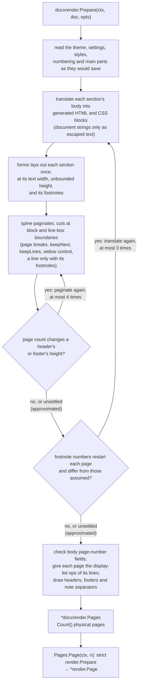

# Word page rendering

This page is the physical-page profile: how `docxrender` lays out and
paginates a Word document, and what it draws exactly, draws
approximately, and leaves out. It is for callers rendering Word pages who
need to know why a document fails, warns, or paginates differently from
Word.
It is part of the [rendering guide](../rendering.md), which has the quick
start and the entry points.

`docxrender.Prepare(ctx, document, opts)` lays out and paginates the complete
document once and returns `*Pages`: `Count()` is the number of **physical
pages** and `Page(ctx, n)` prepares a **1-based** page (a page beyond `Count`
returns `render.ErrInvalid` wrapping `docxrender.ErrPageOutOfRange`). `Pages`
is immutable and safe for concurrent use. `docxrender.PreparePage(ctx, document, n,
opts)` is `Prepare` followed by `Page` and repeats the layout on every call;
`spine-render` uses `Prepare`. The document is never saved or changed, and
unsaved edits are drawn. `Count` and `Page` are physical pages; the number a page
shows (`PAGE`) follows the sections' `w:pgNumType`.

## How a document is drawn

The renderer reads the parts as the document would save them, so nothing the
model preserved is invisible to the checks. Each section's body is translated
into generated HTML and CSS for [forme](https://github.com/mgilbir/forme), the
layout engine under the other renderers, and laid out once at the section's text
width with unbounded height. forme sets a document on one sheet and does not
break flow across pages, so spine paginates: it cuts that layout at block and
line-box boundaries, applying Word's rules, and gives each page the display-list
operations of the lines it holds (text by its baseline; fills and rules by the
line they decorate, with block-level fills clipped at the cut). Everything is
validated or escaped: the only strings from the document that reach forme are
text nodes, escaped as text. Font families are replaced by synthetic names in the
generated CSS and asked of `render.Options.Fonts` as `render.FontRequest`s
(bold and italic included, one request per distinct family, weight and slope
and per document, bounded by `Limits.MaxFonts`); colours and lengths are
formatted from numbers; nothing is loaded from the document.

With `render.Options.Warn` unset (strict mode) anything that is not drawn
exactly fails the call with `render.ErrUnsupported`, wherever in the document
it is. With `Warn` set (best effort) content that is not supported is left out
and reported once per kind, as an error wrapping `render.ErrUnsupported`, and
content that is drawn approximately is reported once per kind as an error
wrapping `render.ErrApproximated`; the rest of the page still draws.

## Drawn exactly

- **Sections.** Page size and margins (and a gutter, added to the left margin)
  per section; section breaks `nextPage`, `continuous` (when page size and
  top/bottom margins match; a different geometry starts a page and is reported as
  approximated), `evenPage` and `oddPage` (by the page number the next page
  shows, with a blank page where needed; a blank page is numbered and has a
  header and footer). A section without an explicit page size or margins fails;
  best effort draws it on Letter with one-inch margins, the page Word's US Normal
  template sets, and reports it.
- **Styles.** Document defaults; paragraph and character styles with `basedOn`
  chains (a cycle in a style the document uses is invalid) and the default
  paragraph style; toggle properties combine across style levels by exclusive or
  (a bold character style on bold text is not bold) and direct formatting
  overrides; theme fonts (`asciiTheme` and the other slots), theme colours with
  `themeTint` and `themeShade` (scaling HSL luminance) through the settings
  colour mapping. Unreferenced styles are never read.
- **Paragraphs.** Alignment (`left`, `start`, `center`, `right`, `end`, `both`);
  left, right, first-line and hanging indents (`start` and `end` as left and
  right); space before and after (kept on the first page, dropped at the top
  of a page that a soft break, a manual page break or `pageBreakBefore`
  started, and kept after a section break, as Word's PDF output shows), the
  larger of one paragraph's space after and the next one's space before
  separating them, also across a section break; a page break that ends its
  paragraph keeps the paragraph mark with it, so no empty line opens the next
  page; with `contextualSpacing` and HTML automatic spacing
  (14 pt); line spacing `auto` (a multiple of the font's line height, 240ths of a
  line), `exact` and `atLeast`. A font's line height is its Windows ascent and
  descent (`usWinAscent` + `usWinDescent`), as Word sets lines, or its ascent,
  descent and line gap when it states none. Text is placed in its line as Word
  places it, line by line by the line's tallest text (measured against Word's
  PDF output): a multiple's extra space below the text (the baseline at the
  Windows ascent), an at-least height's above it, an exact height's baseline
  at four fifths of the line. Approximated: fonts of different proportions on
  one line, and a font whose own ascent or descent is not its Windows one
  beside an inline picture or at an at-least height; `pageBreakBefore`, `keepNext` (a chain taller
  than a page is ignored), `keepLines`, `widowControl` (on by default; the first
  two lines stay together and two lines move to the next page); manual page and
  column breaks (the text after a break is the paragraph's continuation on the
  next page and takes no first-line indent); line breaks; tab stops: default stops
  (`w:defaultTabStop`, from the page margin, with the left indent as the stop of
  a hanging indent's first line), and custom left, center and right stops with
  `dot`, `hyphen` and `underscore` leaders, cleared and inherited through
  styles, which are set by measuring the text between tabs, so they are exact
  while each line between manual breaks is one line of text. The paragraph mark's formatting sizes the last line
  only when it has no text (an empty paragraph, the line after a line break
  that ends the paragraph, or a line of pictures); a line with text is sized by
  its runs, whatever the mark's size, as Word's PDF output shows.
- **Numbering and lists.** `w:numPr` set on a paragraph or through its
  paragraph style (and the styles it is based on) names a `w:num` of
  `numbering.xml`; the level is `w:ilvl`, or the level whose `w:pStyle` names the
  paragraph's style. Counting follows Word: counters belong to the abstract
  numbering (several `w:num` of one `w:abstractNum` continue each other's count),
  a `w:startOverride` restarts its level at the first paragraph of that `w:num`
  there, a `w:lvlOverride` with a `w:lvl` replaces the level, a level restarts
  after a paragraph of a higher level (or after the level `w:lvlRestart` names,
  or never when it is 0), a paragraph that skips levels counts the skipped ones
  as used at their start value, and paragraphs without numbering, other content
  and section breaks do not affect the count. Levels: `w:start`, `w:numFmt`
  (decimal, decimalZero, upper and lower roman and letter, chicago, the enclosed
  and full-width decimals, bullet, none), `w:lvlText` with `%1` to `%9` (each in
  its own level's format, in decimal under `w:isLgl`), `w:suff` (tab, space,
  nothing), `w:lvlJc` (the marker begins at, is centred on, or ends at the
  position where the first line starts), the level's indents and tab stops, and
  its run formatting over the paragraph mark's (font, size, colour, bold...). The
  tab after the marker reaches the hanging indent, a custom stop or the next
  default stop through the tab machinery above, so a paragraph that wraps is
  still exact. With the numbering set directly on the paragraph the level's
  indents replace its style's; with it set by the style the style's indents
  win; direct indents always win. `w:numStyleLink` and `w:styleLink` resolve
  through the numbering style (at most 64 links deep). A paragraph whose list
  is not defined (no numbering part, `w:num`, abstract numbering or level)
  draws without a marker, as Word draws it; `w:numId` 0 removes inherited
  numbering. Bullets in the symbol fonts (Symbol, Wingdings, Wingdings 2 and 3,
  Webdings) are drawn from the private-use code point in that font when the
  host's font resolver provides a face that has it.
- **Runs.** Multiple runs per paragraph; font family per script slot (ASCII,
  high ANSI, East Asian and complex script characters pick the matching
  `rFonts` slot), size, bold, italic (complex-script text uses `bCs`, `iCs` and
  `szCs`); underline `single`, `double` and `thick` (in the underline's colour),
  strikethrough; caps; text colour and `auto`; highlight; solid or clear
  shading; `vertAlign` superscript and subscript (65 % size, raised by 0.33
  and lowered by 0.12 of the run's size) and `position`; hidden text
  (`vanish`, not drawn); soft and non-breaking hyphens; kerning from the `w:kern`
  size (off otherwise); text beyond the margin that has no break opportunity
  wraps at the margin. Optional OpenType ligatures, contextual alternates and
  kerning are disabled unless asked for, matching Word's default.
  Text is drawn in the scripts forme shapes; characters the supplied fonts lack
  fail (`render.ErrUnsupported`).
- **Headers and footers.** `w:headerReference` and `w:footerReference` of the
  types `default`, `first` (with `w:titlePg`, on the first page a section opens)
  and `even` (with `w:evenAndOddHeaders`, by the displayed page number); a type
  a section does not reference is inherited from the previous section, and one
  nobody defines is blank. The content is translated by the body's code
  (paragraphs and every other block kind the profile draws), laid out at the
  section's text width, and drawn from the `w:pgMar` header and footer
  distances. A header that reaches past the top margin moves the text area down,
  and a footer past the bottom margin moves it up, and pagination uses the
  reduced height. Blank pages inserted for even and odd section breaks have
  them too.
- **Page numbers.** `w:pgNumType` `start` (restart at the section's first page)
  and `fmt` (`decimal`, `decimalZero`, `upperRoman`, `lowerRoman`,
  `upperLetter`, `lowerLetter`, `chicago`). In headers and footers `PAGE`,
  `NUMPAGES`, `SECTIONPAGES` and `SECTION` fields and the `w:pgNum` placeholder
  show the real values, in the section's format for `PAGE` and with the
  `\* Arabic`, `roman`, `ROMAN`, `alphabetic` and `ALPHABETIC` switches
  (`MERGEFORMAT` is accepted). `NUMPAGES` and `SECTIONPAGES` are only known
  after pagination, and the page count can change a header's height (a wider
  number wraps): pagination is repeated, at most four times, while the heights
  it assumed differ from the result; where it does not settle the last
  pagination is kept and reported as approximated. Other fields in headers
  and footers show their cached result.
- **Fields and links.** The cached result of simple and complex fields, across
  paragraphs, is drawn and the instruction is not; hyperlink text is drawn with
  its run formatting. In the body the cached result of `PAGE` and the other
  page-number fields is drawn, as Word saved it, and checked against the
  value the field has on the page it lands on: a result that differs is
  reported as approximated.
- **Footnotes.** `w:footnoteReference` draws the note's mark (its number in the
  `w:footnotePr` `numFmt`, from `numStart`, restarting by `numRestart`:
  `continuous`, `eachSect` or `eachPage`; properties from the settings part and
  the section) in the run's own formatting, and the note's text (translated by
  the body's code, with its `w:footnoteRef` mark) goes to the bottom of the text
  area of the page that holds the reference's line, under the separator
  (144 pt from the start of the line, from the separator note) in the order of the
  references. The area reduces the text area for pagination: a line is placed
  only if it and its notes fit. A note that does not fit whole is cut at a line
  and continues on the next page under the continuation separator (also 144 pt
  long, as Word draws it), before that page's own notes. Footnote text that restarts numbering on
  every page is translated again with the numbers pagination gives (at most
  three times). `w:customMarkFollows` references use the text that follows as the
  mark.
- **Endnotes.** `w:endnoteReference` marks (lower-case Roman by default) and the
  notes, which follow the body text of the document, or of each section for
  `w:pos` `sectEnd`, after the endnote separator, as ordinary flow.
- **Pictures.** A `w:drawing` that holds a picture (`pic:pic`) is drawn from
  the image its `r:embed` relationship names in the part being translated: PNG,
  JPEG and GIF (the first frame), and EMF and WMF, which are played onto a
  raster of about twice the frame's pixels (never below half, within the image
  budget) with the metafile playback `internal/metafile` shares with PowerPoint,
  described under PowerPoint pictures above: gowemf plays the records, the page
  painter's scan conversion draws them, and strict mode fails on anything not
  drawn exactly while best effort reports what it approximates or leaves out
  and draws the rest. An EMF+ file is drawn from its EMF+ records when they can
  all be drawn, else from its GDI records. Playback is charged to the render
  limits and checks cancellation in every drawing call. A metafile is drawn once, at the
  size of the first picture to use it. The image is read from the package, never from
  a path or URL the document writes; linked pictures (`r:link`, external
  relationships) are not loaded. Each image part is decoded once, under
  `Limits.MaxImageBytes` and `MaxImagePixels`, and a picture is cut, filled,
  flipped, rotated and given its colour effects into one raster, sized to what is
  drawn (at most four image pixels per drawn pixel) and shared by equal pictures.
  Supported: the frame (`wp:extent`), `a:srcRect` crops (negative values extend
  the picture with transparent pixels), `a:fillRect` insets, `flipH`, `flipV` and
  any rotation (resampled, with antialiased edges), `wp:effectExtent` (the room
  around the frame, so rotated pictures take their bounding box), picture colour
  effects (grayscale, bi-level, duotone, colour change and replacement, HSL
  shifts, alpha effects and fill overlays, the pixel code `pptxrender` uses) with
  sRGB, theme and system colours, a solid picture outline (`a:ln`, drawn centred
  on the frame's edge for unrotated pictures), SVG pictures through their PNG
  fallback, hidden drawings (`wp:docPr hidden`, not drawn).
  - **Inline** pictures (`wp:inline`) sit on the text line like a large glyph,
    their bottom on the baseline: the line grows to hold them, they move with
    their line across pages, and a picture taller than the page is clipped by it.
  - **Anchored** pictures (`wp:anchor`) belong to the page of their anchor line.
    Without wrapping (`wrapNone`, in front of or `behindDoc` behind the text) the
    picture is drawn at its position: `relativeFrom` page, margin, column, left,
    right, inside and outside margins, paragraph, line, character and
    top and bottom margins, with `posOffset` or `align`, or `simplePos`; text is
    unaffected, as in Word, and `relativeHeight` orders overlapping pictures.
    Square, tight, through and top-and-bottom wrapping around a picture positioned
    from its paragraph or line (offset zero or aligned to the top) is a float in
    the layout: text wraps around it on the side `wrapText` names (`left`,
    `right`, `largest`, and `bothSides` where the picture touches an edge of the
    text) at the wrap distances, and it moves with its paragraph. The wrapped
    text around a float is laid out where the float is, so a float and the
    paragraph's lines stay together on one page. In a table cell, where Word
    places the picture relative to the cell (`layoutInCell`), which is not
    implemented, an anchored picture is drawn on its line, where the same
    picture inline would be: strict mode fails, best effort reports it.
- Content controls, smart tags and custom XML wrappers draw their content.
- **Tables.** The table grid and the columns it gives (fixed and autofit
  layouts: an autofit table is drawn by the grid Word stored, which is what Word
  computed), `w:tblW` as points or a percentage of the text width (of the cell,
  in a nested table), alignment and indent (the table's edge sits at the indent
  in compatibility mode 15, and the first cell's text at it in older modes, as in
  Word), cell margins from the cell, the row exception (`w:tblPrEx`), the table
  and its style, measured from the grid line, and vertical alignment. Borders:
  the table's outer and inside borders, table style layers and cell borders, as
  single, double, dotted and dashed lines with their width and colour, where
  neighbouring cells of the same size share an edge by Word's rule (the heavier
  line, then the darker colour, then the first cell). Shading from the cell,
  the table and the style (clear and solid fills, theme colours). `gridSpan`,
  `vMerge`, the legacy `hMerge`, `gridBefore` and `gridAfter`, row heights
  (`atLeast`, and `exact` while the text fits), hidden rows, and nested tables.
  Table styles: `basedOn` chains, the default table style, the whole-table layer
  and every conditional layer (first and last row and column, banded rows and
  columns with their band sizes, corner cells) selected by `w:tblLook`, with the
  style's paragraph and run formatting beneath paragraph styles and direct
  formatting. Cells hold paragraphs (with tab stops) and nested tables.
  Pagination cuts a table between rows; a row without `w:cantSplit` is also cut
  between the lines of its cells, where no line is crossed; a `cantSplit` row
  moves to the next page whole unless it is taller than a page; header rows
  (`w:tblHeader`, from the first row) are drawn again on each page the table
  continues on and are not left alone at the foot of a page; rows whose
  paragraphs all keep with next stay with the next row, and a keep-with-next
  paragraph before a table stays with its first row; the borders at a cut are
  drawn whole on both pages. Rows a vertical merge joins are cut only between
  the lines of the merged cell.

## Drawn approximately

Reported with `render.ErrApproximated` in best effort and refused in strict
mode: tab stops in a paragraph whose lines wrap (the tab widths assume the text
between manual breaks fits on one line), decimal stops (set as right stops), bar
stops (not drawn), the heavy and middle-dot leaders (drawn with an underscore and
a dot); justified
`distribute` and kashida alignment (justified); a justified line before a manual
line break (Word stretches it, this does not); character spacing (`w:spacing`, not
applied: the shared rasterizer draws no letter spacing); small caps (synthesized
by forme); underline styles other than single, double and thick (drawn as a
single line, as forme draws only solid lines) and double strikethrough
(single); shading patterns (not drawn); right-to-left paragraphs and runs (laid
out with the bidirectional algorithm, but alignment of `left` and `right` is not
mirrored as Word does); character-unit and line-unit indents and spacing (not
applied); tracked changes (insertions shown, deletions dropped, as the final
text); settings that change layout and are not modelled (mirrored margins,
automatic hyphenation, book fold, ...); multiple text columns and the document
grid (laid out as one column); a continuous section break across different page
geometries; footnote text that continues for more than half a page (a page
takes at most half its text area of continued note text and the rest goes to the
next page); a footnote continuation notice that has text (not drawn), footnotes
beneath the text or at the end of a section or document (drawn at the page
bottom), and endnotes that continue on another page (the continuation separator
is not drawn); footnote numbers that restart on every page and do not settle; a
body page number field whose saved result differs from the page it is on (or
has none to compare); a
page number format other than those listed (decimal is drawn),
chapter numbers in page numbers, other field switches on page number fields, a
page break inside a header or footer, and a header and footer that leave no room
for text on the page (the text area keeps the margins); list markers in a symbol font the host does not provide (a
Unicode bullet of similar look is drawn in the paragraph's font), picture
bullets (a bullet character), number formats other than those listed above
(Hebrew, Arabic, Thai, Japanese and Chinese counting, ...) and values a format
cannot express (roman numerals above 3999 or below 1, letters below 1,
enclosed circles above 20), which draw in decimal, the English text formats
(`ordinal`, `cardinalText`, `ordinalText`), which Word writes in the document's
language, and marker text that refers to a deeper level; floating tables
(`w:tblpPr`, drawn in the text flow), cell spacing
(drawn without), right-to-left tables, a table width or cell widths (`w:tcW`)
that differ from the grid (drawn by the grid, or, for an autofit table, scaled
to the table width), a grid without column widths, an autofit column too narrow
for an unbreakable word (the word overflows; Word widens the column), `noWrap`
cells in autofit tables, text taller than an `exact` row height (drawn, not
clipped), page breaks in a cell (`pageBreakBefore` and manual breaks are not
applied), borders in other styles than the four above (drawn solid), border
shadows, shading patterns, row alignment, vertical text in cells, `tcFitText`,
justified vertical alignment, tracked changes to rows and cells, and borders
shared by cells of different sizes whose lines differ (forme's rule decides); pictures: tight and through wrapping (drawn around the picture's
box, not its outline), `bothSides` wrapping of a picture with text room on both
sides (the larger side), a wrapped picture offset below the top of its paragraph
(text beside the space above it is displaced), a wrapped picture positioned from
the page or margin (drawn there, without text wrapping around it), wrapping that
crosses a page boundary, inside and outside positions (drawn as left and right),
a picture placed from its character with wrapping (from the column), a picture
in a line of exact height (Word clips it; the line grows), tab stops beside a
floating picture, picture shapes other than a rectangle, a tiled picture fill,
shadow, glow and 3-D picture effects (not drawn), picture artistic effects, a
dashed picture outline (solid) and a rotated picture's outline (not drawn),
brightness and contrast (drawn as LibreOffice does), tint, blur and gradient
overlays, picture colour effects with colour transforms (the effects are skipped)
and effects colours other than sRGB, theme and system colours.

## Left out

Reported as unsupported in best effort and refused in strict mode: diagonal cell
borders, table, row and cell properties and elements this profile does not know,
content of merged cells that a merge hides, pictures that cannot be drawn
(linked, missing, corrupt, in a format other than PNG, JPEG, GIF, EMF and WMF,
or too large to decode: an inline one keeps its space), legacy VML pictures (`w:pict`),
charts, SmartArt, shapes, text boxes, groups and other non-picture drawings (an
inline one keeps its space), alternate content, notes the document does not
have, notes in headers, footers and notes, comments, equations,
embedded objects, symbols, form fields, paragraph and run borders, paragraph
shading, frames, page borders, line numbering, vertical page alignment, text
direction other than left to right, page background, text effects, and every
element or property this profile does not know.

## Defined by the profile

Native line metrics (the font's own ascent, descent and line gap, with leading
split equally above and below a line; Word distributes extra leading
differently), the superscript and subscript scale and offset, the double
underline's spacing, automatic hyphenation (none), and the shaping engine decide
the exact placement; identical Word pagination is not promised. Pagination
follows the rules above on those metrics.

Tables are laid out by forme as CSS tables with collapsing borders and fixed
columns; the renderer computes what Word decides (columns, margins as padding,
every cell's borders, shading, heights) and hands them over as numbers. Where
that differs from Word the profile decides: the text inset of a cell is its
margin from the grid line (the half of a border wider than the margin is the
inset instead), a row that only holds the continuation of a vertical merge takes
its height from the other rows, a row aligned other than to the top is kept whole
rather than re-aligned in each part when it is cut, and only table placement
differs between compatibility modes.

## Budgets

The budgets of a Word document are listed in
[DOCX budgets](limits.md#docx-budgets).
