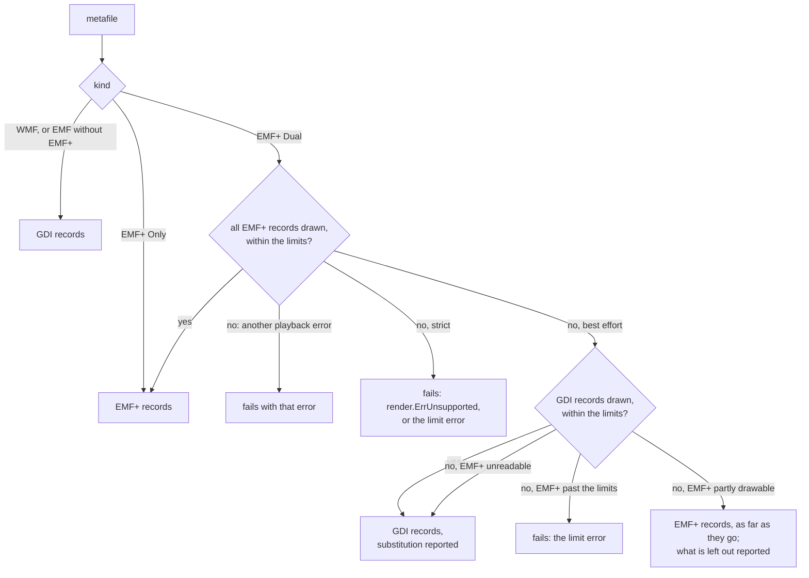

# EMF and WMF pictures

This page describes how EMF and WMF pictures are played: on slides, as
pictures, picture fills and backgrounds, and on Word pages, as pictures.
It is for readers whose slides or Word documents carry EMF or WMF
pictures.
It is part of the [rendering guide](../rendering.md), which has the quick
start and the entry points.

EMF and WMF pictures, as picture shapes, picture fills and picture
backgrounds, are drawn onto a transparent raster of the size the picture is
drawn at, up to two pixels per CSS pixel and never below half; the raster then
goes through the [picture machinery](pptx.md#pictures) (crop, flips, effects, tiling). The
records are played by [gowemf](https://github.com/mgilbir/gowemf)'s `Play`,
which keeps the GDI device context and the GDI+ graphics state and resolves
every drawing record into paths, paints, images and text runs in raster
coordinates. `internal/metafile` draws those with the page painter's scan
conversion (eight vertical samples, exact horizontal coverage) rather than
through the display list, which fills only by the even-odd rule and has no
strokes or arbitrary clip regions. A metafile fills its picture area (an EMF's
frame, a placeable WMF's bounds, else a WMF's window) over the picture's box.

The raster is the device GDI draws on, as when Office plays a picture onto a
page: GDI lines run through its pixel centres, a pen is never narrower than one
of its pixels and a hairline is one pixel wide. EMF shapes include their right
and bottom edges, as Windows plays them; WMF keeps GM_COMPATIBLE's rule
(MS-EMF 2.1.16) and leaves them out. Drawn exactly, in the sense of this page:
everything gowemf plays (its `COVERAGE.md` is the inventory), among it the
mapping modes, window, viewport and world transforms, saved states; pens with
their caps, joins, user dashes and compound bands; solid, hatched, pattern and
DIB brushes, and in EMF+ GDI+'s 53 hatches, textures, linear and path
gradients; paths, filled, stroked and as clips, and region clips; bitmaps
copied, inverted, alpha-blended or color-keyed, and a black-and-white mask
followed by its sprite as one image with alpha; gradient fills; EMF+ metafile
images; and text in the fonts the caller's `Fonts` resolver supplies. Text is
decoded from Unicode, the Windows code pages and the double-byte character
sets; DEFAULT_CHARSET text is read as a Western system writes it, in
Windows-1252. Each run of one bidirectional level is shaped by forme in that
level's direction, mirrored at odd levels, without the optional ligatures,
contextual alternates and kerning ExtTextOut does not apply to simple text
(complex scripts and right-to-left runs keep the font's rules, as Uniscribe
applies them). Glyph-index text is drawn only in the face it indexes, matched by
family or PostScript name.

An EMF+ file is drawn from its EMF+ records, as GDI+ draws it, when every one
of them can be drawn within the limits; an EMF+ Only file is always drawn from
them. A Dual file whose EMF+ records cannot all be drawn is drawn from the GDI
records it carries for readers that cannot, when gowemf can read those, and the
substitution is reported.

Which records a picture is drawn from:

Strict mode fails with `render.ErrUnsupported` for anything not drawn exactly;
best effort draws the rest and reports each detail once, as approximated or left
out: what gowemf reports it cannot play (its `UnsupportedOperation`s, such as
EMF+ custom line caps, which stay off), preset pen dashes (drawn at Windows'
display lengths), a font's set character width (drawn at its own width),
characters a face lacks and glyph indexes in a substitute face (left out), and
raster operations that combine with the destination beyond a mask and sprite
pair (left out: a picture's destination is the page under it, which its raster
does not have). Malformed files fail; best effort stops at a record gowemf
cannot read and keeps what came before it. All budgets apply: the raster's
pixels count against the unique-image pixel budget; drawing operations,
flattened and stroked segments, scan work, pixel visits, clip masks (sixteen
rasters), glyphs, fonts and text shaping (`MaxShapeWork`, `MaxRunBytes`) are
charged to the render limits; gowemf's path points and decoded bitmap pixels
are bounded by `MaxPathSegments` and `MaxImagePixels` across the metafile; and
cancellation is checked in every drawing call and between rows.
